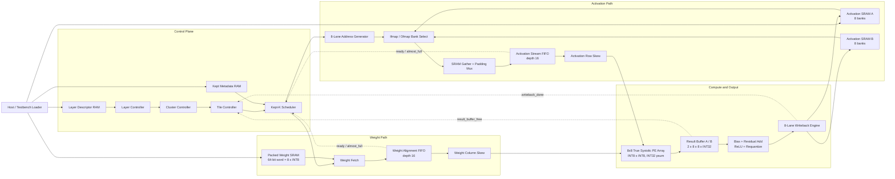
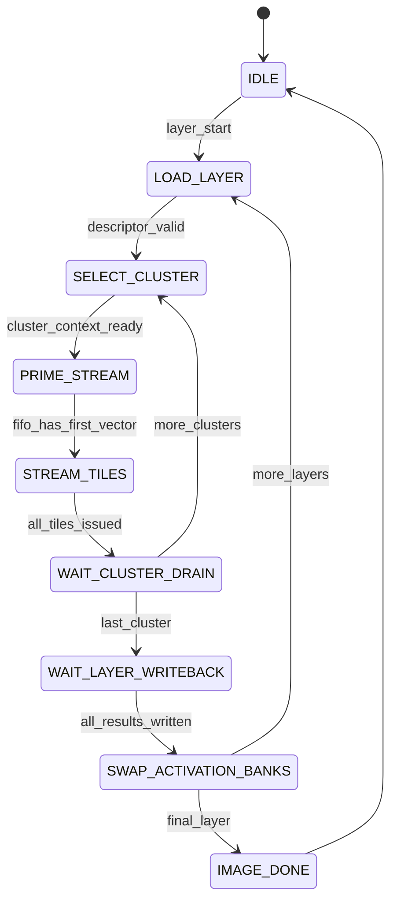
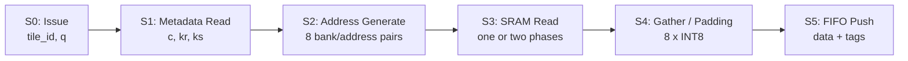
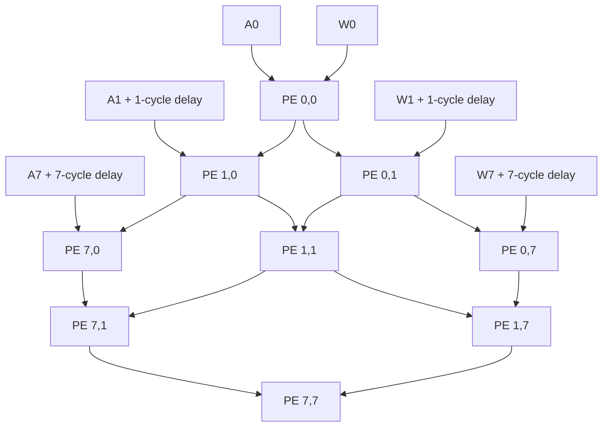

# Mask-Aware CNN Accelerator V1

本文件定義第一版硬體的 cycle-level 架構。目標是讓軟體輸出的
`kept_count`、kept metadata 與 packed weights，直接驅動 On-the-Fly
activation stream，不產生完整 im2col matrix。

## 1. 支援範圍

| 項目 | V1 規格 |
|---|---|
| Convolution | `groups=1` 的一般 Conv2d |
| Kernel | 1x1、3x3 |
| Stride | 1、2 |
| Padding | 0、1 |
| Batch | 1 |
| PE Array | 8x8 true systolic |
| PE rows | 最多 8 個同一 output row 的 output pixels |
| PE columns | 同一 filter cluster 的 8 個 output channels (`Tm=8`) |
| Dataflow | Output stationary |
| Activation / Weight | signed INT8 |
| Product / Accumulator | signed INT16 / signed INT32 |
| Output | requantized INT8 |
| Metadata entry | `{channel, kernel_row, kernel_col}`，建議 16 bits |
| 暫不支援 | Depthwise、grouped convolution、MobileNetV2 硬體路徑 |

## 2. Top-Level Block Diagram



控制路徑只決定目前的 layer、cluster、Tile 與 kept entry。Data Feeder
負責將這些資訊轉成真正的 Ifmap SRAM bank/address，並形成 PE 所需的
8-lane activation stream。

## 3. 軟體輸入格式

### 3.1 Layer Descriptor

```text
cin, cout
hin, win
hout, wout
kernel_h, kernel_w
stride, padding
cluster_count = ceil(cout / 8)
pixel_tile_count_per_row = ceil(wout / 8)
```

### 3.2 Cluster Descriptor

```text
kept_count
metadata_base
weight_base
output_channel_base
valid_filter_mask[7:0]
```

最後一個 cluster 若不足 8 個 filters，以 `valid_filter_mask` 關閉無效 PE
columns 與 writeback lanes。

### 3.3 Kept Metadata

軟體不要只輸出線性 `kept_k` 後再要求硬體做除法與 modulo。V1 直接輸出：

```text
metadata[q] = {input_channel, kernel_row, kernel_col}
```

建議 16-bit 格式：

```text
[15:4] input_channel
[3:2]  kernel_row
[1:0]  kernel_col
```

### 3.4 Packed Weight Layout

每個 `q` 使用一個 64-bit word：

```text
weight_word[q] = {w7, w6, w5, w4, w3, w2, w1, w0}
```

`wj` 是目前 cluster 中 filter `j` 在 kept entry `q` 的 INT8 weight。

## 4. Controller Hierarchy



`STREAM_TILES` 不是「算完一個 Tile 才開始下一個 Tile」的 FSM。它是一個
可被 backpressure 暫停的 stream producer：

```text
for tile in current output row:
    for q in 0 .. kept_count-1:
        issue(tile, q)
```

當 `q=kept_count-1` issue 後，下一個可接受的 cycle 立即 issue 下一個 Tile
的 `q=0`。

## 5. Mask-Aware Data Feeder

### 5.1 每個 kept entry 的地址

Tile 中 lane `i` 對應 output pixel：

```text
ox[i] = tile_x_base + i
oy[i] = tile_y
```

metadata `q` 提供 `(c, kr, ks)`：

```text
ix[i] = ox[i] * stride + ks - padding
iy[i] = oy[i] * stride + kr - padding
```

若超出 `(0 <= ix < Win, 0 <= iy < Hin)`，padding mux 直接輸出 INT8 0，
不對 SRAM 發出 read。

### 5.2 8-Bank Activation SRAM

V1 使用 8 banks，Activation SRAM 採用 channel-major、X-interleaved layout：

```text
bank      = x mod 8
bank_addr = (channel * H + y) * ceil(W / 8) + floor(x / 8)
```

Stride=1 的 8 個連續 pixels 會落在 8 個不同 banks；若地址跨 bank-address
boundary，由 gather router 對回正確 lane。這個 layout 也讓 writeback 能以
「同一 output channel 的 8 個連續 pixels」一次寫入 8 banks。

Stride=2 使用兩個 gather phase：

```text
phase 0: lanes 0, 1, 2, 3
phase 1: lanes 4, 5, 6, 7
```

兩個 phase 收集到 staging register 後，才產生一筆完整 8-lane vector。
因此：

```text
stride=1 feeder initiation interval = 1 cycle/vector
stride=2 feeder initiation interval = 2 cycles/vector
```

PE 結構不因 stride 改變，只會在 stride=2 時看到較疏的 `vector_valid`。

### 5.3 Feeder Pipeline



Activation FIFO entry：

```text
activation[7:0] : 8 x INT8
tile_tag        : at least 1 bit for result-buffer bank selection
first_k         : 1 bit
last_k          : 1 bit
pixel_valid     : 8 bits
q / weight_addr : kept entry index
```

Weight path 另有 depth-16 alignment FIFO。Scheduler 對 activation 與 weight
發出同一個 issue sequence；只有當兩個 FIFO head 的 `q`、`tile_tag`、
`first_k`、`last_k` 全部相同且兩邊都 ready 時，pairing logic 才能同時 pop，
送入 row/column skew。這可吸收 Ifmap gather 與 Weight SRAM read latency 的差異，
也能在 stride=2 activation 需要兩個 gather phases 時保持資料對齊。

## 6. True Systolic Timing

矩陣對應：

```text
A_tile[8, kept_count] x B_cluster[kept_count, 8] = C_tile[8, 8]
```

- Activation lane `i` 延遲 `i` cycles 後從 PE row `i` 左側注入。
- Weight lane `j` 延遲 `j` cycles 後從 PE column `j` 上方注入。
- Activation 向右移動，weight 向下移動，INT32 psum 留在 PE。
- 同一個 `q` 在 `PE[i][j]` 於 source injection cycle `q+i+j` 相遇。



每個 PE 必須讓 tag 與資料一起 pipeline。PE 的動作：

```text
valid && first_k: psum = activation * weight
valid && middle_k: psum += activation * weight
valid && last_k: result_buffer[tile_tag][i][j] = psum + product
```

若同一筆同時為 `first_k && last_k`，結果就是單一 product。

## 7. Tile 0 到 Tile 1 的 Cycle-Level 範例

以下使用：

```text
stride = 1
kept_count = 4
Data Feeder latency = 3 cycles（簡化示例）
```

### 7.1 Source / Feeder Pipeline

| Cycle | Issue Stage | SRAM/Gather | Inject to skew |
|---:|---|---|---|
| 0 | T0 q0 | - | - |
| 1 | T0 q1 | T0 q0 | - |
| 2 | T0 q2 | T0 q1 | - |
| 3 | T0 q3 | T0 q2 | T0 q0 `first_k` |
| 4 | **T1 q0** | T0 q3 | T0 q1 |
| 5 | T1 q1 | T1 q0 | T0 q2 |
| 6 | T1 q2 | T1 q1 | T0 q3 `last_k` |
| 7 | T1 q3 | T1 q2 | T1 q0 `first_k` |
| 8 | T2 q0（若 result bank 可預約） | T1 q3 | T1 q1 |

Tile 0 的最後一個地址 issue 後，下一 cycle 已開始讀 Tile 1。沒有等待 Tile 0
writeback，也沒有建立完整 activation Tile buffer。

### 7.2 Systolic Wavefront

T0 q0 在 cycle 3 注入，T0 q3 在 cycle 6 注入：

```text
PE[0][0] receives T0 q0 at cycle 3
PE[7][7] receives T0 q0 at cycle 17

PE[0][0] completes T0 at cycle 6
PE[7][7] completes T0 at cycle 20
```

T1 q0 在 cycle 7 注入：

```text
PE[0][0] starts T1 at cycle 7
PE[7][7] starts T1 at cycle 21
```

對每一顆 PE 而言，舊 Tile 的 `last_k` 與新 Tile 的 `first_k` 相隔一 cycle，
因此可以連續切換 psum，不需要全陣列一起停下來 drain。

## 8. Result Buffer 與 Writeback

Result Buffer 使用 A/B 兩個 banks：

```text
Bank A captures Tile 0 results diagonally
Bank B captures Tile 1 results diagonally
```

Result 不必等整個 Tile 完成才開始寫回。當 `PE[7][j]` 收到 `last_k` 時，
代表 column `j` 的 8 個 pixel results 都已進入 Result Buffer，控制器設定
`column_complete[j]`。Writeback Engine 下一 cycle 讀取該 PE column（8 x INT32），
也就是同一 output channel 的 8 個連續 output pixels。完成 bias、residual、
ReLU 與 requantization 後，8 個 INT8 outputs 分別寫入 Activation SRAM 的
8 個 X banks。

```text
column 0 complete -> write column 0
column 1 complete -> write column 1
...
column 7 complete -> write column 7 -> release result bank
```

因為 systolic wavefront 讓 columns 依序完成，Writeback 可與 array tail 重疊，
不會在 `PE[7][7]` 完成後才額外增加完整 8 cycles。

若最後一個 Tile 不滿 8 pixels，`pixel_valid[7:0]` 關閉無效 bank writes；若
最後一個 cluster 不滿 8 filters，`valid_filter_mask[7:0]` 跳過無效 columns。

穩定 source Tile 啟動間隔：

```text
tile_interval >= max(kept_count * feeder_II, 8)
```

因此：

- `kept_count >= 8` 且 stride=1：compute/feed 通常是瓶頸，A/B buffer 可隱藏寫回。
- `kept_count < 8`：writeback 可能成為瓶頸；若兩個 result banks 都忙，Tile
  Controller 必須在下一個 Tile 邊界暫停 issue。
- 後續可用 16-lane writeback、第三個 result bank，或融合更寬 Ofmap SRAM
  改善，但不列入 V1。

## 9. Ready/Valid 與 Stall 條件

Kept-K Scheduler 只有在以下條件都成立時才能 issue：

```text
metadata_ready
weight_path_ready
activation_fifo_not_almost_full
weight_fifo_not_almost_full
target_result_buffer_reserved
```

Tile 開始前先預約一個 result-buffer bank。允許預約仍在寫回的 bank，但必須保證
該 bank 會在新 Tile 的第一個 result 到達前釋放；`kept_count >= 8` 時 A/B bank
通常可交替滿足此條件。`kept_count < 8` 時若預測會衝突，Scheduler 必須在 Tile
boundary stall。Tile 一旦開始，除非 FIFO 或 SRAM 回傳 backpressure，應連續
issue 所有 `q`。

主要訊號：

| 介面 | 訊號 |
|---|---|
| Scheduler -> Feeder | `issue_valid`, `tile_tag`, `tile_x`, `tile_y`, `q`, `first_k`, `last_k` |
| Feeder -> FIFO | `act_valid`, `act[8]`, `pixel_valid`, tags |
| Weight -> FIFO | `weight_valid`, `weight[8]`, `q`, tags |
| FIFO Pair -> Skew | paired `activation[8]`, `weight[8]`, tags |
| Skew -> PE | lane-wise `valid`, `data`, `tile_tag`, `first_k`, `last_k` |
| PE -> Result Buffer | `result_valid[i][j]`, `result_data[i][j]`, `tile_tag` |
| Result Buffer -> Controller | `bank_free[1:0]`, `column_complete[1:0][7:0]` |
| Writeback -> Controller | `writeback_done`, `bank_release` |

## 10. Activation SRAM Ping-Pong

Activation SRAM A/B 是 layer-level ping-pong，不是 Tile buffer：

```text
Layer N:
    SRAM A = Ifmap (read)
    SRAM B = Ofmap (write)

Layer N+1:
    SRAM B = Ifmap (read)
    SRAM A = Ofmap (write)
```

Residual block 的 skip tensor 生命週期跨越多個 convolution，V1 完整模型仍需額外
Skip Buffer，或以 bank allocation 保留舊 activation。這不影響單一 convolution
資料路徑，但必須在 ResNet top-level controller 中處理。

## 11. V1 Cycle Model

不計 Host Loader 與 layer/cluster context 切換時，一個 cluster 的近似 cycles：

```text
pixel_tile_count = Hout * ceil(Wout / 8) # 每列不跨 row 分 Tile
II = 1 for stride 1, 2 for stride 2
tile_issue_cycles = max(kept_count * II, 8)

cluster_cycles ~= feeder_pipeline_latency
                + pixel_tile_count * tile_issue_cycles
                + systolic_tail_latency
```

其中 8 是單一 writeback engine 的每 Tile 寫回時間；systolic tail 最多約
`8 + 8 - 2 = 14` cycles。實際 RTL cycle counter 應另外統計：

```text
cycles_total
cycles_feeder_stall
cycles_result_buffer_stall
cycles_stride2_gather
cycles_pe_valid
cycles_writeback_busy
```

## 12. 建議 RTL 實作順序

1. `pe.sv`：INT8 multiply、INT32 psum、first/last tag 行為。
2. `systolic_array_8x8.sv`：activation/weight forwarding 與 row/column skew。
3. `result_buffer.sv`：A/B bank、64 個 diagonal result capture、column complete 與 bank release。
4. `kept_k_scheduler.sv`：cluster/Tile/q counter 與 result-bank reservation。
5. `mask_aware_data_feeder.sv`：metadata、地址、padding、stride 1/2 gather。
6. `packed_weight_fetch.sv`：64-bit packed word 與 tag 對齊。
7. `writeback_engine.sv`：8 columns、post-process、Ofmap SRAM address。
8. `conv_accelerator_top.sv`：控制器、Activation SRAM A/B、Host loader。

第一個測試案例建議使用小尺寸：

```text
Cin=2, Cout=8, Hin=4, Win=8
kernel=3x3, stride=1, padding=1
kept_count=4, one filter cluster
two output pixel Tiles per row
```

先比對 Python golden output，再加入 stride=2、最後 Tile 不滿 8 pixels、最後
cluster 不滿 8 filters 與 backpressure 測試。
