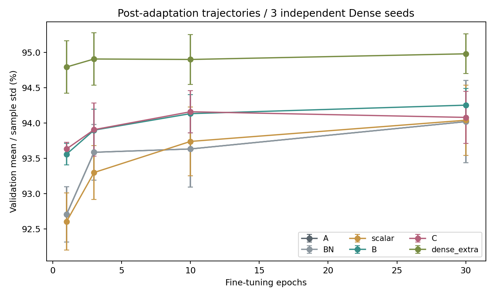

# 研究發現與完整實驗紀錄

更新日期：2026-11-05。範圍：本專案已保存的CNN剪枝、共享mask補償、相關量化旁證，以及目前研究決策。

本文件是給自己、指導教授及另一個模型閱讀的研究總檔。數據以連結的原始CSV/報告為準，不將不同split、Dense checkpoint、配額或訓練預算的結果混成排名。

「新亮點」指本專案目前新發現且值得研究的現象，不代表已證明學術首創。單seed負結果也不是對整類方法的不可能性證明。

## 0. 一頁結論

1. **目前主線：共享mask下的保留權重補償，以B Dense-input ridge為主。** 不換mask、不加回連接、不改kept_count，在ResNet50三個獨立Dense seeds中，FT10平均優於A/BN-only 0.500pp、優於per-filter scalar 0.393pp。
2. **補償收益不是單純BN校正或純量縮放就能完全取代。** 便宜控制已實際補跑，不能只與很差的raw FT0相比。
3. **長微調會縮小優勢，但本輪平均未完全消失。** FT30的B-A為+0.233pp、B-scalar為+0.213pp；B-A僅2/3seeds為正，不能宣稱所有seed都更好或收斂後普遍提升。
4. **C逐層補償並非越複雜越好。** FT10的C-B僅+0.027pp；FT30為-0.173pp，三seeds均低於B。C的可能價值在zero/極少FT，而非目前最終精度主線。
5. **共享位置限制留下可量測的經驗差距。** FT10同逐filter q的非共享mask參考94.580%，A93.633%，B94.133%；B補回約52.8%的這個平均差距。這不是精度數學上界。
6. **多輪搜尋共同顯示：代理指標下降，不保證FT後分類更好。** L1分組代價、activation加權代價、局部重建誤差、搜尋CE，都出現改善但FT10未勝過強控制的案例。
7. **保護敏感層必須一起檢查實際預算。** 只保護不補剪，target90%可能只實際剪59%至74%；補回預算則可能把其他層剪壞，尤其本批DenseNet121。
8. **停止新增分組搜尋及activation加權實驗。** 補償感知mask選擇仍是延伸，尚未實作；先把固定mask補償的證據做完整。

截至本日，補償主線仍只有ResNet50/約90%/三Dense seeds的validation證據。5seeds、跨模型、80/95%、校正量/lambda消融、獨立test確認及最新補償模型的INT8都尚未完成。

## 1. 讀數據前必須知道的比較規則

### 1.1 單位與資料集

- Accuracy是百分比；兩個accuracy相減用percentage point（pp）。94.133%-93.633%=0.500pp，不是提升0.5%的相對錯誤率。
- 早期核心`resnet34_pruning_experiments.py`將`after_extra_or_ft_acc`記為test accuracy；近期研究worker用5000張validation。
- 不能把舊ResNet50 test 92.933%與新validation 94.133%相減，宣稱補償提升1.200pp。
- CIFAR-10 test歷史上已在早期實驗使用，不能事後稱為完全未接觸的test。近期主線沒有新test forward。
- 早期部分量化以validation影像校正；最新補償則以train內fit/check校正，兩者不是同一評估規則。

### 1.2 稀疏度與預算

- 主要分母為納入剪枝的卷積權重，不是整個模型含FC/BN的全部parameters。
- 設定target不代表實際達到：共享K位置取整、敏感層保護及cap都會影響實際值。
- 相同weight sparsity不等於相同逐層MAC、SRAM traffic、cycle或energy。
- 相同每cluster q並維持同一層，可精確匹配該配置的卷積MAC預算；但不保證實際硬體存取成本相同。
- Mask保留位置恰為數值0，不代表kept-K scheduler自動少跑一個cycle。本輪42個checkpoint恰好沒有此差異，仍須區分兩個定義。

### 1.3 Seeds與統計

- 正式三seeds指三個獨立100epoch Dense訓練，seed0/1/2，不是同一Dense的三次分組初始化。
- 同Dense seed內對照方法使用相同FT RNG、資料順序、增強與訓練設定。
- 配對std是先逐seed相減再計算sample std，不是兩個accuracy std相減。
- 三個random grouping初始化不等於三個獨立Dense seeds。
- 圖中的sample std不是95% confidence interval；n=3、平均正值或3/3正值都不等於已證明統計顯著。
- 預先0.2/0.3pp等門檻是投入控制，不是顯著性檢定，也不是未達門檻就證明無效。

### 1.4 原始性與硬體界線

本文件記錄專案實證，不將ridge、OBS、activation score、channel permutation或共享矩陣分解本身稱為首創。既有文獻對照見[參考論文紀錄](2026-11-01_pruning_reference_papers.md)及[已發表數據並列](2026-11-02_published_pruning_comparison.md)。後者不是同訓練條件排名。

MAC/PE利用率是軟體估算；現有`paper_cycle_estimate`不是目前8x8 output-stationary RTL的cycle-accurate模擬。本文不新增RTL審查，也不據舊硬體待辦判定另一個repository最新完成度。

## 2. 實驗地圖與目前決策

| 類別 | 做過什麼 | 證據範圍 | 目前決策 |
|---|---|---|---|
| 早期多模型/ratio/top-k/protected | 短Dense訓練、FT2，探索可行性 | 基準偏低，跨run可能不同 | 保留歷史，不作主要提升數字 |
| 固定Dense ratio/Tm掃描 | 五模型、70/80/85/90/95%、Tm8/16、FT10 | 三Dense seeds、歷史test | 保留正式基準 |
| Importance-only | l1/max/top2/top4，實際約90% | 五模型、三seeds、歷史test | 有模型特定小收益，無統一贏家 |
| 單層sensitivity | filter_l1及cross top2/top4，逐層剪 | 早期e5診斷及後續固定Dense validation排名 | 診斷有用，不能直接當全網分配最優解 |
| 保護/重新分配 | skip最敏感層、cap其餘、補足90% | 五模型、三seeds、歷史test | 啟發式非普遍有效 |
| 舊Jaccard分組 | binary keep mask相似度、貪婪等大小組 | 45組配對，組別q也會變 | 歷史正訊號，不能只歸因分組 |
| 固定q重新分組 | continuous/random/norm/Jaccard/swap | ResNet50 seed0、7個FT10分支、val | 未達擴展門檻；停止新投入 |
| Activation-aware | per-patch RMS score，連續/最佳化 | 同上四格，新增2分支、val | 本版本退步；停止新投入 |
| 局部重建mask修補 | mean/worst/mean-safe等 | 五模型診斷、兩模型16個新FT分支、val | proxy改善，分類未支持 |
| 全網CE接受mask | frozen/recalibrated BN、dual/search-only | ResNet50 seed0、4新分支、val | 主方法未勝過l1 |
| 適應後梯度交換 | 2epochs適應、共享gate梯度、8epochs FT | ResNet50 seed0、4分支、val | 未超過匹配random及強控制 |
| 固定support ridge | A/B/C同mask、FT10 | ResNet50三Dense seeds、9分支、val | 轉為主線 |
| BN/scalar/FT30/非共享參考 | 補齊便宜控制與長微調 | 三Dense seeds、24軌跡、val | 支持B固定預算收益，需更多確認 |
| 量化旁證 | Dense INT8/9/10、ResNet34 pruned INT8/Q15 | 不同模型/ratio/backend的歷史測試 | 不外推最新ResNet50補償INT8 |
| 補償感知mask | 以refit後重建目標選位置 | 尚未實作 | 延伸，不列已完成成果 |

## 3. 基礎定義：我們究竟剪什麼

一般卷積weight為`[Cout,Cin,Kh,Kw]`，flatten後每個filter有`K=Cin*Kh*Kw`個位置。Tm個filters共用一份K mask；同一位置一起保留或一起移除，數值仍各自不同。

- 3x3、Cin=3時K=27，不是9。
- 1x1、Cin=64時K=64，不是把整個filter當一個權重。
- 只有某cluster的kept_count=0，才是該組所有K位置皆被刪除。
- grouped/depthwise的local weight K為`Cin/groups*Kh*Kw`，且不同filters未必共用同一輸入。不能直接套一般卷積的activation broadcast硬體收益。

重要性沿組內filters計算：`l1_sum=sum(abs(W))`；`max_abs=max(abs(W))`；`top2/top4_mean_abs`為取最大2/4個絕對值的平均。score中的top4不是「四個敏感層」。

global_cluster流程先對全部納入的卷積權重作global magnitude reference，再依每layer/cluster的reference零比例決定要移除的K位置數。cross mask重新從Dense weights選位置，不是永久global剪完後只能從剩下的位置再剪。

## 4. 早期探索與固定Dense：先修好比較方式

### 做過什麼

早期多模型、ratio、top-k/protected-cap使用短訓練，例如Dense5epochs、FT2。曾看見剪枝FT後高於Dense extra或ratio70高於60。後來改為同model/seed共用固定Dense100 checkpoint，加入同預算Dense extra，正式FT10、三seeds。

### 已確認的問題

早期各run的Dense狀態/收斂程度、保護造成的實際剪枝量與短訓練變異，使raw accuracy不能當公平方法排名。剪枝後較高不自動代表剪枝更好，可能混入追加訓練、正則化、BN及seed變異；本專案未逐一分離所有成因。

### 現在怎麼更好

使用固定checkpoint ID/SHA、相同FT RNG與budget，分別列Dense100、Dense extra及pruned FT。ResNet50三seed Dense validation平均94.833%，Dense extra FT10為94.900%、FT30為94.980%。歷史Dense test平均94.247%，不能與validation補償相減。

早期檔案仍保留：[top-k/protected探索](../runs/improvement_topk_protect_cifar10_split/README.md)、[sensitivity-aware探索](../runs/sensitivity_aware_topk_cifar10_split/README.md)、[舊l1保護對照](../runs/sensitivity_aware_l1_sum_cifar10_split/README.md)。這些README的早期「目前結論」不是最新主線判斷。

## 5. 固定Dense、多模型ratio/Tm：微調不是萬能

正式歷史test比較，損失相對同seed Dense extra，單位pp：

| 模型 | Tm8/70% | Tm8/80% | Tm8/90% | Tm8/95% | Tm16/90% |
|---|---:|---:|---:|---:|---:|
| ResNet34 | 0.260 | 0.350 | 0.783 | 2.157 | 1.377 |
| ResNet50 | 0.207 | 0.453 | 1.330 | 2.153 | 1.703 |
| GoogLeNet | 0.293 | 0.707 | 1.637 | 3.583 | 2.257 |
| DenseNet121 | 0.417 | 0.740 | 1.630 | 3.823 | 2.297 |
| MobileNetV2 | 1.977 | 2.727 | 3.363 | 4.337 | 4.920 |

已確認：提高到95%時損失明顯增大，不能說剪多少都能靠FT救回。這組離散掃描中Tm8優於Tm16，ResNet34較有韌性，MobileNetV2較敏感。

可能解釋：較大Tm的共享限制更強；MobileNetV2較精簡且含depthwise/pointwise。但本輪沒有把各結構原因逐一隔離，也不把結果當成任意模型的定理。

如何用：作ratio與cluster大小的accuracy取捨基準，不把某模型最高測試可接受ratio當成精確臨界點。ResNet34/Tm8在90到95%間是否有更細臨界尚未搜尋。

證據：[完整表/曲線](../runs/fixed_checkpoint_all_ratio_summary/README.md)、[原始合併CSV](../runs/fixed_checkpoint_all_ratio_summary/all_results_combined.csv)。最新ridge補償尚未擴80/95%，不能把本表當ridge掃描。

## 6. Importance-only：有模型特定收益，但沒有一個準則全面勝出

實際約90%、Tm8、三seed歷史test，無保護/cap：

| 模型 | l1_sum (%) | 事後觀察最佳criterion | 最佳 (%) | 提升 (pp) |
|---|---:|---|---:|---:|
| ResNet34 | 94.007 | max_abs | 94.123 | +0.117 |
| ResNet50 | 92.933 | top2_mean_abs | 93.313 | +0.380 |
| GoogLeNet | 92.460 | top2_mean_abs | 92.517 | +0.057 |
| DenseNet121 | 93.587 | top4_mean_abs | 93.727 | +0.140 |
| MobileNetV2 | 81.960 | top2_mean_abs | 82.170 | +0.210 |

已確認：替換weight aggregation有小幅、模型依賴的改善。未確認：這些差異是否統計顯著、能否預先選出統一最好準則。

為什麼不足以主打：這是各模型事後選贏家，不是一個固定新演算法全面勝出；不能把不同模型的最佳列混稱同一方法。top-k也不直接考慮輸入相關性或被剪後可補償程度。

決策：保留公平控制，不再以無限換score為主線。證據：[正式總表](../runs/FAIR_PRUNING_R0P9_FINAL.md)、[逐seed配對](../runs/fair_criterion_r0p9_tm8/paired_vs_l1.csv)。

## 7. 單層敏感度、保護與補剪：診斷有用，分配仍可能失敗

### 7.1 敏感度做過什麼

早期逐層測試filter_l1（整filter移除）及cross top2/top4共享mask，ratio10/30/50/70/90，不做FT。例子：DenseNet121的stem及transition 1x1、MobileNetV2的features.0.0常敏感；ResNet50 stem亦敏感。

早期合併CSV包含e5 checkpoints，例如ResNet34首列Dense81.68%。後續正式保護另有固定Dense100、各seed的validation top2 ranking，以50/60/70%單層drop建立排名。兩套排名不能混稱同一protocol。

已確認：特定模型/剪法/比例下單層drop不同；整filter與共享K pruning的排名可不同。可能原因包含入網特徵抽取、transition通道壓縮及BN失配，但未隔離哪個原因造成全部敏感度。

單層無FT drop不等於全網聯合剪枝的最佳配額，也不是不可恢復精度損失。證據：[早期heatmap與排名](../runs/layer_sensitivity_summary/README.md)、[正式固定Dense sensitivity目錄](../runs/fixed_checkpoint_multi_model/sensitivity_validation/)。

### 7.2 保護但不補剪

`top_k=4`是保護前4個敏感層；`skip_top_k=1`使最敏感第1層不剪；其餘3層cap20%，其他層cap75%。它們與score的top2/top4不是同一件事。

已確認：此策略可使target85至95%的實際sparsity只達約59至74%。精度較高同時受「保留更多weights」影響，不是同90%預算的勝利。

### 7.3 精確補回約90%預算

啟發式依單層敏感度控制mobility，用二分搜尋與整數修正將少剪份額補到其他cluster，並匹配原總移除權重數；沒有每次補剪就重新評估全網交互作用。

top2三seed歷史test：

| 模型 | 無保護loss (pp) | 保護+補剪loss | 變化：後者-前者 |
|---|---:|---:|---:|
| ResNet34 | 0.853 | 0.947 | +0.093 |
| ResNet50 | 0.950 | 1.210 | +0.260 |
| GoogLeNet | 1.580 | 1.717 | +0.137 |
| DenseNet121 | 1.607 | 8.207 | +6.600 |
| MobileNetV2 | 3.153 | 2.310 | -0.843 |

差值由未取整的原始平均計算，可能與表面三位小數相減差0.001pp。

DenseNet121的top2補剪loss std約5.758pp；l1補剪平均loss12.390pp，std約9.337pp，不能只引用均值。

已確認：本啟發式只在MobileNetV2有幫助，並非普遍有效；同weight budget下MAC也未完全匹配。

可能解釋：單層排名不捕捉多層聯合退化；補剪可能把原來可承受的層推到另一個區域。尚未證明某一個transition、1x1或DenseNet結構就是唯一原因。

現在怎麼更好：任何保護都報actual budget與可行性；新主線先固定原mask與q，不把保護/分配混入補償。其他分配演算法仍可能可行，但本版不作主要貢獻。

證據：[完整方法與判斷](2026-11-01_sensitivity_budget_findings.md)、[三seed統計](../runs/sensitivity_redistributed_r0p9_tm8/method_summary.csv)。

## 8. 相似分組到固定q搜尋：先前正訊號不能直接當純分組效果

### 8.1 舊Jaccard分組

先產生global unstructured binary keep masks，以Jaccard相似度配對，優先處理難配對filter，再貪婪湊滿8個。只記filter IDs，不改模型channel順序。

三seed、80/85/90%共45組配對。在90%時相對連續分組的歷史test提升：ResNet34 +0.063、ResNet50 +0.353、GoogLeNet +0.350、DenseNet121 +0.160、MobileNetV2 +2.783pp。

重要混淆：重新分組也重新計算每組global_cluster q；無法分開group membership與配額重分配的收益。MobileNetV2的大提升未完成pointwise/depthwise歸因，不能直接變成一般卷積硬體共享activation收益。

證據：[完整45組表](../runs/filter_similarity_grouping/README.md)。[invalid_mask_remap歷史目錄](../runs/filter_similarity_grouping_invalid_mask_remap/)不納入正式結論，保留作追溯。

### 8.2 固定每層每組q重新驗證

ResNet50 seed0、Tm8、89.9987%實際sparsity，改用layer reference固定同層所有groups的q，七分支FT10。此配置與舊global_cluster不同，不是舊分組收益的精確因果分解。

| 方法 | Validation FT10 (%) | L1缺口閉合 (%) |
|---|---:|---:|
| 連續 | 93.20 | 0.00 |
| random0 | 93.20 | -0.03 |
| random1 | 93.52 | +0.04 |
| random2 | 93.30 | +0.02 |
| L1 norm排序 | 92.78 | -2.91 |
| Jaccard | 93.04 | +9.74 |
| Jaccard+交換 | 93.38 | +13.47 |

交換搜尋以組內刪除L1質量為目標，4輪有界交換，嚴格下降才接受。獨立每filter top-q作代理下界，不是分類精度下界；zero gap不硬算比率。

已確認：代理代價下降，FT10僅+0.18pp；random平均93.34%、初始化std0.164pp，交換版僅高於平均0.04pp且低於random1。

不能說：因為下降代價13.47%，所以分類更好13.47%；也不能說分組整類無效。沒有足夠證據超過random，本版未達事前0.3pp擴展門檻，停止新投入。

可能原因：刪除L1質量不是分類loss；貪婪/局部搜尋有限。未分離哪個因素主導，不以增加搜尋次數追高。

證據：[方法/配對數據](2026-11-02_fixed_quota_regrouping_findings.md)、[結果圖](../runs/fixed_quota_filter_regrouping/README.md)。

## 9. Activation-aware分數：更好地優化自己的proxy，仍可能更差

用512張train影像、Dense eval FP32 forward，對每(c,r,s) unfold位置收集FP64 RMS，含padding/stride/dilation，令`S=abs(W)*RMS`。分組交換與mask排序都用同一S，q及FT流程不變。

四格ResNet50 seed0 validation：

| 指標 | 連續分組 FT10 | 最佳化分組 FT10 |
|---|---:|---:|
| L1 | 93.20% | 93.38% |
| Activation-aware | 92.48% | 92.90% |

同一activation proxy的刪除代價依序為2781.54、2740.83、2697.02、2644.05；新指標確實優化自己的目標，但精度下降0.72/0.48pp。

已確認：不能只報新指標內分組+0.42pp，因為最終仍低於L1；optimized兩列的score與產生的groups同時不同，不能說只換mask。

可能解釋：RMS只描述輸入能量，不完整描述分類敏感度、位置間相關性或微調可恢復性。這些是限制假說，不是已證明的唯一失敗原因。

決策：不繼續投入此分數或分組搜尋。此負結果不否定把完整輸入相關性放入重建目標，後者與一個RMS縮放係數不同；也不證明所有activation-aware方法無效。

證據：[完整四格與限制](../runs/activation_aware_fixed_quota_grouping/FINDINGS.md)、[逐層proxy](../runs/activation_aware_fixed_quota_grouping/prepared/seed0/layer_metrics.csv)。

## 10. 固定q的mask修補、CE與梯度：測過的其他失敗路徑

### 10.1 局部重建誤差修補

改mask位置，不重算kept weights。以Dense-input patches上的mean/worst相對重建誤差選交換，固定q；後來加mean-safe限制。五模型seed0診斷最壞誤差改善約10.8至36.3%。

分類pilot兩模型、16個新FT10分支及復用控制：

| 版本/模型 | l1 | mean repair | worst repair | random |
|---|---:|---:|---:|---:|
| v1 ResNet50 | 93.46 | 93.40 | 93.40 | 93.28 |
| v1 DenseNet121 | 93.84 | 93.64 | 93.74 | 94.04 |
| mean-safe ResNet50 | 93.46 | 93.06 | 93.02 | 93.56 |
| mean-safe DenseNet121 | 93.84 | 93.88 | 93.52 | 94.08 |

已確認：獨立check重建指標改善沒有轉成主方法分類優勢；mean-safe亦未解決，random有時更好。

可能原因：Dense輸入的局部誤差不能完整代表全網pruned prefix、分類目標及FT後狀態。沒有證明所有重建目標都無效。

如何避免重複：不能只換proxy或加更多局部輪數就重新宣稱新貢獻。後續補償方法改的是保留權重，不是這個只換mask的舊版本。

證據：[完整v1/v3表](../runs/shared_mask_repair_study/FINAL_REPORT.md)。

### 10.2 全網分類CE接受/否決mask

候選仍來自已固定的mean/worst局部mask庫；在整個剪枝網路逐層接受候選。search512/check512/audit1024皆來自互斥train，check被用於決策，不是獨立測試。

ResNet50 seed0 validation FT10：l1 93.46%；frozen-BN dual 93.24%；recalibrated-BN dual 93.20%；兩個search-only消融93.48/93.54%。

已確認：主方法dual沒過事前門檻，search-only最高只+0.08pp；不能事後改挑消融當主方法。

可能原因：候選庫不足、未訓練模型CE對可訓練性預測有限、逐層貪婪交互作用；尚未分離確認。決策是不擴三seed、不讀test追有利設定。

證據：[完整報告](../runs/task_loss_mask_study/FINAL_REPORT.md)。

### 10.3 適應2epochs後的共享gate梯度交換

先讓相同pruned模型適應2epochs，再以共同gate導數`D_k=sum_i W_ik*dL/dW_ik`提出每cluster同q交換，剩餘8epochs保持optimizer/scaler/RNG連續。四分支總預算均10epochs。

| ResNet50 seed0 | FT10 validation |
|---|---:|
| 無交換 | 93.46% |
| 全部梯度候選交換 | 93.52% |
| 雙CE gate | 93.54% |
| 匹配交換數random | 93.58% |

主方法未超過random，也未超過本輪強控制93.68%。導數實作正確、mask配額正確，不等於分類有效。

這是一次有界gradient regrowth，不是所有Taylor/Fisher importance或訓練期稀疏方法都被否定。停止擴展此版本。

證據：[配額/梯度總結](../runs/BASELINE_AND_GRADIENT_20261102.md)、[梯度原始報告](../runs/adapted_gradient_mask_study/FINAL_REPORT.md)。

### 10.4 原文配額粒度審核

原文圖示/文字的spatial subcluster與單一G(c,r,s)門檻存在操作性歧義，測flat整個K與按(r,s)分配但總q相同的版本。不是已確認作者程式。

seed0 validation spatial-flat：ResNet34 l1 +0.14、top2 -0.04；ResNet50 l1 -0.06、top2 +0.26pp。1x1 mask完全相同。最大差未達0.3pp擴展門檻，不是兩解讀等效證明，也不足解釋與原論文數pp的raw差距。

證據：[原文操作性審核](../runs/spatial_quota_baseline_study/PAPER_AUDIT.md)、[基準表](../runs/spatial_quota_baseline_study/BASELINE_REPORT.md)。

## 11. 真正較有支持的轉折：固定共享support，補償保留權重

### 11.1 B簡單版的數學定義

令X為`[K,N]`校正patches、Y為`[Tm,N]`的Dense pre-BN Conv outputs，S為固定kept集合。只調整`U[Tm,q]`：

```text
min_U ||U X_S - Y||_F^2 / N + lambda ||U-W_S||_F^2
G = X_S X_S^T / N
R = X_S (Y-W_S X_S)^T / N
U = W_S + solve(G+lambda I, R)^T
lambda = max(1e-8, 0.001 * mean(diag(G)))
```

用FP64 Cholesky、8個右手邊共用同一分解，再存FP32。check patches的實際FP32重建MSE若變差，整cluster退回原kept weights。q=0不加回連接；q=K沿用原值。lambda/jitter規則固定，不在本輪調參。

Dense-input B用teacher的X；C按實際forward順序，用目前student prefix的新X去重建相同Dense Y，BN/FC離線不改。C的target不能簡化成student X乘原Dense W，必須解完整residual regression。

### 11.2 為什麼這與之前修補不同

以前多數路徑在選「留哪些位置」；補償方法固定位置後，讓保留權重吸收部分被剪連接的輸出貢獻。它不需要改硬體kept_k或cluster IDs，仍有相同結構mask與規劃MAC預算。

這是工程/方法適配亮點，不是已證明學術首創；ridge/OBS類重建與共享矩陣概念已有既有工作。共享一次分解解8個RHS，不代表整個程序實測8倍快。

## 12. 最新補強：BN、scalar、FT30、非共享參考

### 12.1 設定與完成範圍

ResNet50/Tm8，三個獨立Dense seeds。沿用原global_cluster共享mask；每seed保留卷積weights分別2,344,856/2,344,552/2,344,352。原mask q=0 clusters為43/26/209，沒有用補償加回。

完成24條軌跡：A/BN/scalar/B/C/Dense extra六類各三seeds到FT30；global/quota unstructured各三seeds到FT10。A/B/C重用原FT10完整state續跑，不重訓或重啟optimizer。沒有5seeds或新test評估。

BN控制只重置/校正running statistics；scalar為每filter最小平方alpha縮放，den極小取1，允許負值、不調clip，與B同check-cluster fallback。所有新枝同constant SGD lr0.001、batch128、AMP float16、FT RNG。

### 12.2 完整曲線數字

三seed validation平均（%）：

| 方法 | FT0 | FT1 | FT3 | FT10 | FT30 |
|---|---:|---:|---:|---:|---:|
| A | 10.707 | 92.707 | 93.587 | 93.633 | 94.020 |
| BN-only | 75.453 | 92.707 | 93.587 | 93.633 | 94.020 |
| Scalar | 39.713 | 92.607 | 93.300 | 93.740 | 94.040 |
| B ridge | 81.540 | 93.560 | 93.900 | 94.133 | 94.253 |
| C逐層ridge | 91.467 | 93.633 | 93.907 | 94.160 | 94.080 |
| Global U | 60.507 | 94.480 | 94.560 | 94.600 | 未跑 |
| Quota U | 15.867 | 94.073 | 94.307 | 94.580 | 未跑 |
| Dense extra | 94.833 | 94.793 | 94.907 | 94.900 | 94.980 |



### 12.3 亮點A：B超過BN與一個很便宜的縮放控制

| 配對差值 | FT1 mean +/- paired std (pp) | FT10 | FT30 |
|---|---:|---:|---:|
| B-A/BN | +0.853 +/- 0.242 | +0.500 +/- 0.399 | +0.233 +/- 0.351 |
| B-scalar | +0.953 +/- 0.253 | +0.393 +/- 0.300 | +0.213 +/- 0.300 |

FT10 B-scalar逐seed +0.38/+0.70/+0.10pp，三個為正。FT30 +0.56/+0.04/+0.04pp，仍三個為正，但兩個只差0.04pp。

B-A在FT30為+0.60/+0.20/-0.10pp，不能隱藏seed2反例。平均收益縮小、變異仍大，支持固定budget初步收益，不支持「完全收斂後所有seed都更好」。FT30沒有預先定義收斂停止準則，不能直接稱已完全收斂。

### 12.4 亮點B：BN混淆已直接控制

BN-only可大幅改善FT0，但正常training BN下，A/BN從FT1起validation相同；FT10/30三seed的全部parameters、optimizer、scaler、RNG逐bit相同。少數running buffers仍差5.605e-45，num_batches_tracked亦可不同，所以不稱整個state bit-exact。

不能把raw A10.7到C91.5的約80pp差距全當權重補償效果。共同BN副本的既有FT0為A75.45、B90.12、C90.45%，更能看出大幅差距中BN與權重重建的不同角色。副本未帶入B/C主FT。

A和BN雖回答不同控制問題，不是兩份獨立統計證據。

### 12.5 亮點C：較簡單B比C更值得作最終精度主線

C-B的配對平均：FT0 +9.927pp；FT1 +0.073；FT3 +0.007；FT10 +0.027；FT30 -0.173 +/- 0.133pp。FT30三seed C都低於B。

因此B作主線，C留作zero/極少FT的比較。C的raw FT0優勢也受BN一致性影響，不能只看FT0就稱全面較好。

### 12.6 亮點D：將總剪枝與共享位置的差距拆開

只比較FT10：

```text
Dense extra 94.900 - global U 94.600 = 0.300 pp
Quota U 94.580 - A 93.633 = 0.947 pp
Quota U 94.580 - B 94.133 = 0.447 pp
B補回比例 = 0.500 / 0.947 = 約52.8%
```

這是目前L1共享mask相對獨立top-q的經驗差距，不是共享結構不可避免的最低代價。兩種U參考沒有FT30，不拿U/FT10去計算「FT30共享代價」。

若改用Dense extra當分母，FT10 B補回約39.5%、C約41.6%的Dense差距；不是上面的52.8%。FT30 B相對Dense extra差距補回約24.3%。比率必須寫明分母，均不是accuracy或錯誤率提升這麼多百分比。

### 12.7 成本、正確性與目前能寫的主張

- Scalar離線本輪約6.64秒；BN約0.137秒；B/C舊紀錄約25.66/35.30秒。測量日期/負載不同，不以比值宣稱倍速。
- FT30路徑約380至397秒/分支，不含全部teacher/cache準備、診斷與排隊。不用epochs直接換成總time-to-accuracy。
- 63項tests及42個FT10/30 checkpoint、2226個Conv層狀態稽核通過，禁止位置非零為0、保留位置恰為0亦為0。
- Mask/kept_k/kept_count不變，不代表量化誤差、SRAM實測、energy或cycle已驗證。

建議論文敘述：

> 在固定cross-filter共享support與相同微調預算下，Dense-input ridge補償在ResNet50/CIFAR-10三個獨立Dense seeds的validation中，FT10較未補償提升0.500pp、較每filter純量縮放提升0.393pp。長微調至FT30後平均增益縮小，並存在相對未補償模型的單seed反例，因此目前結果支持有限預算的初步收益，而非普遍最終精度優勢。

證據：[完整研究判斷](../runs/compensation_controls_ft30/FINDINGS.md)、[主表/圖](../runs/compensation_controls_ft30/README.md)、[逐seed/epoch](../runs/compensation_controls_ft30/validation_long.csv)、[配對統計](../runs/compensation_controls_ft30/paired_differences.csv)、[成本](../runs/compensation_controls_ft30/costs.csv)、[數值稀疏度稽核](../runs/compensation_controls_ft30/numerical_sparsity_audit.csv)。

## 13. 為什麼「不行」：已證實與仍屬假說的分界

| 方法 | 已觀察、可確認 | 可能解釋，尚未隔離證實 | 不能下的結論 |
|---|---|---|---|
| 保護未補剪 | 實際sparsity降低 | 位置保護/額外weights各占多少收益 | 同90%下已贏 |
| 保護+補剪 | 四模型退步，MobileNet改善 | 高比例聯合層退化、單層排名不足 | 所有分配都無效 |
| 舊相似分組 | 某些模型有歷史改善，q也變 | grouping與allocation各自作用 | 收益全來自相似性 |
| 固定q L1搜尋 | proxy下降但只+0.18pp | L1失真、局部最優、FT動態 | 所有重分組無效 |
| Activation RMS | 自己proxy更低但accuracy更差 | 能量不等於task重要性、忽略相關性 | 所有activation資訊沒用 |
| 局部重建repair | check MSE改善不帶來FT優勢 | teacher input mismatch、誤差傳播 | 所有重建補償無效 |
| CE接受mask | dual沒贏，消融小幅差 | 候選庫不足、未訓練proxy不預測FT | 所有task-aware選擇無效 |
| 適應後梯度 | 未勝過匹配random/強控制 | 校正梯度噪音、一次更新/候選限制 | Taylor/Fisher整類失敗 |
| BN-only | FT0有用，FT後等同A | 正常BN訓練覆蓋running stats | BN校正在任何模式都無用 |
| Scalar | FT10/30只有小平均收益 | 尺度不足以表達所需方向修正 | 只要縮放就等同ridge |
| B長FT | 平均優勢縮小且A有單seed反例 | baseline追上、初始化差異/訓練動態 | 已證明收斂後永遠更好 |
| C逐層 | FT30三seed均低於B | 前層適配目標/校正代表性/FT動態 | C在所有低FT情境都較差 |

共同教訓是「代理正確」與「分類有效」分開驗證；避免負結果出來就無限換proxy、改seed或挑epoch。

## 14. 量化與硬體旁證：可用，但不可外推

### 14.1 Dense INT8/9/10歷史PTQ

五模型三seeds、完整CIFAR-10 test；2048張validation校正、per-channel signed symmetric weights、per-layer activation、fake quant、INT32 accumulator。五模型平均loss為INT8 0.099pp、INT9 0.034pp、INT10 0.021pp。不是最新補償pruned模型，也不是RTL bit-exact。

ResNet34 seed0固定權重倍率對照：x32加INT8 activation為21.36%、x64為89.25%、x128為94.40%、x256為94.64%，校正式per-channel INT8為94.80%。已確認全模型固定小倍率會失去解析度；不代表任何power-of-two scaling都不好。

證據：[Dense PTQ設定/表格](../runs/quantization_dense_ptq/README.md)。

### 14.2 ResNet34剪枝+量化

80%剪枝、Jaccard分組、l1/Tm8、FT10，oneDNN FX INT8歷史test平均94.537%，對pruned FP32 94.500%差+0.037pp。這個小正差不是量化提高精度的普遍證據；oneDNN affine activation與signed-zero-point0硬體並非相同數值規格。

另外的硬體軟體reference狀態文件記錄ResNet34三seed端到端Q15：相似分組平均94.390%，contiguous平均94.30%。這些是特定ResNet34/80%模型，不是本輪ResNet50/90% ridge。

證據：[oneDNN結果與限制](../runs/pruned_int8_simulation/README.md)、[另一repository量化軟體狀態](../../mask_aware_conv_accelerator/docs/SOFTWARE_QUANTIZATION_STATUS.md)。該狀態文件的RTL待辦可能落後硬體新版本，本次未據此判定最新RTL是否完成。

### 14.3 目前補償主線還缺什麼

新權重會改變range與量化參數，不能直接套舊Dense/ResNet34的INT8 loss。已檢查的ResNet34 bit-exact reference走conv1/conv2 block，不能直接當ResNet50 Bottleneck conv3的完整reference。

需另驗證ResNet50的完整數值圖、per-channel scales、bias/INT32 overflow、Q15 rounding/residual/ReLU/saturation，以及補償權重的INT8 accuracy。目前均不列本輪已完成成果。

保留同mask意味kept metadata與規劃工作量不變；仍沒有新的實測RTL area、Fmax、SRAM accesses、功耗或加速數據。硬體dataflow/kept-K規劃可見[架構文件](../hardware/ARCHITECTURE_V1.md)，它不是本輪合成結果。

## 15. 工程問題與如何解決

| 問題 | 如何處理 | 科學解讀上的教訓 |
|---|---|---|
| 早期Dense不一致/短訓練 | 固定checkpoint ID/SHA與獨立Dense seeds，配對FT RNG | 不用不同baseline相減 |
| target與actual混用 | 實際mask counts、逐層/cluster q、MAC分開報 | 保護較好可能只是少剪 |
| 非連續groups映射風險 | 按原filter IDs散佈full mask，加入optimizer/regrowth tests | 不將mask按cluster順序直接展開 |
| 舊invalid mask remap結果 | 保留在invalid目錄，不列正式資料 | 失敗資料不能無標記回流總表 |
| 搜尋/報表程式錯誤 | 保存原source/log與明確修訂，不改方法追val | 程式修正與方法改動須分開 |
| 續訓中斷/長跑 | epoch checkpoint含optimizer/scaler/Python/NumPy/Torch/CUDA/loader RNG | 不能只載weights再說同一軌跡 |
| 多job OOM/kill | 保留failed logs，之後限制並行及可用RAM/VRAM/磁碟 | 顯存空閒不等於無限並行；未確認的kill原因不亂歸責 |
| 補償主線報表比較NumPy array | 獨立report-only finalizer用np.array_equal，新增回歸tests | 不改凍結訓練，不重算模型 |
| MKL/OpenMP衝突 | 保存失敗輸出，以GNU threading layer重跑報表 | 報表環境失敗不等於訓練失敗 |
| BN state非完全bit-exact | 分開parameters、running buffers、counter及驗證精度 | 不把5.6e-45殘值說成整state相同 |

各批EXECUTION_LOG/execution.jsonl保留詳細事件。本輪補償控制的問題處理見[EXECUTION_LOG](../runs/compensation_controls_ft30/EXECUTION_LOG.md)及[REPORTING_FIX](../runs/compensation_controls_ft30/REPORTING_FIX.json)。

## 16. 接下來怎麼更好，以及明確不再做什麼

### P0：維持方法不變，確認B的穩定性

本輪已達預先5seed投入資格：B在FT10或FT30對BN/scalar均平均>=0.2pp，且至少2/3seeds同時為正。這是投入門檻，不是顯著性證據。下一輪應新增兩個獨立Dense訓練，而不是對同一Dense換兩個FT seeds湊數。

固定B、scalar、A及必要C控制的規則再確認，不在新seeds上調lambda或挑epoch。C仍留短FT比較，但不因舊FT10平均高0.027pp就當主線。

### P1：有限跨模型、ratio與設計消融

先選一個一般卷積第二模型，如ResNet34或GoogLeNet；MobileNetV2的group/depthwise需另定輸入/共享H的映射，不能直接套本ResNet50 worker。

之後分批做80/95%、512/2048校正量、lambda及Dense-input/student-prefix消融，每次只改一組因素。早期其他方法做過80/95%不代表最新ridge已做。

若要主張少FT效率，預先定義目標accuracy與停止規則，測包含校正/求解的完整time-to-accuracy；不能從目前均值曲線就宣稱實測倍速。

### P2：補償感知mask延伸，尚未實作

對比「L1 mask+B」與「補償後重建目標選mask+B」，固定每cluster q、資料、lambda及FT。先在小型case確認預測代價與重新求解後實測誤差一致，再擴模型。

Gram可能因樣本不足/相關性奇異；K最大4608而patches最多4096時不可直接假設可逆。需要對齊prior-centered ridge與damping，C的student X/teacher Y不能偷換成Dense-input公式。批次刪除有交互作用，單位置OBS分數相加只是近似，不能冒充精確joint代價。

共享support可共用分解是效率設計依據，不是已確認新貢獻，也不保證整體8倍快。未來新穎性仍需與OBC/SparseGPT及group/block相關工作對照。

### 不再新增的實驗

- 不再擴目前Jaccard/L1交換分組或RMS activation加權分支。
- 不再單憑局部proxy更低就擴大昂貴FT。
- 不在test、seed或最佳epoch上追有利數字。
- 不把保護少剪、不同Dense、不同MAC或不同split當成純方法收益。

## 17. 文件與資料入口

優先閱讀順序：本總檔 -> [最新補償研究判斷](../runs/compensation_controls_ft30/FINDINGS.md) -> [原始配對CSV](../runs/compensation_controls_ft30/paired_differences.csv) -> 各批source/VALIDATION/EXECUTION_LOG。

| 主題 | 入口 |
|---|---|
| 最新便宜控制/FT30 | [報告與圖](../runs/compensation_controls_ft30/README.md)、[ZIP](../runs/compensation_controls_ft30.zip) |
| 最初三seed補償 | [報告](../runs/fixed_mask_weight_compensation/FINAL_REPORT.md) |
| 固定q分組 | [報告](../runs/fixed_quota_filter_regrouping/README.md) |
| Activation四格 | [報告](../runs/activation_aware_fixed_quota_grouping/README.md) |
| 局部修補 | [報告](../runs/shared_mask_repair_study/FINAL_REPORT.md) |
| 整網CE | [報告](../runs/task_loss_mask_study/FINAL_REPORT.md) |
| 配額審核/梯度 | [總結](../runs/BASELINE_AND_GRADIENT_20261102.md) |
| Importance/重新分配 | [正式歷史test總表](../runs/FAIR_PRUNING_R0P9_FINAL.md) |
| Ratio/Tm | [固定Dense總表](../runs/fixed_checkpoint_all_ratio_summary/README.md) |
| 層敏感度 | [早期總表](../runs/layer_sensitivity_summary/README.md) |
| 量化 | [Dense PTQ](../runs/quantization_dense_ptq/README.md)、[pruned oneDNN](../runs/pruned_int8_simulation/README.md) |
| 全部runs索引 | [runs/README](../runs/README.md) |

本次只整理文件，不新增訓練、不重跑test、不修改既有實驗快照或checksum。原始數據、負結果、失敗logs與大型checkpoint保持原位置。

## 18. 未核對或不納入目前正式主線的範圍

- Animals-10/ImageFolder已有準備或執行腳本，不等於已有與本輪相同protocol的完整結果。本總檔未將其列為補償方法的正式跨資料集證據；若要補列，需另核對各run的manifest、資料路徑及完成狀態。
- EfficientNetV2-M有早期探索/learning-rate smoke檔案，但不在目前五模型固定對照與ResNet50補償證據鏈中，不把它加入正式五模型平均。
- 另一硬體repository可能已有比舊架構/量化狀態文件更新的RTL。本文只檢查指定軟體reference與歷史數據，不判定最新RTL功能、合成或板上測試是否完成。
- 論文原始accuracy較低、別的論文accuracy較高，都不是本方法因果提升的直接證明；應回到同checkpoint、同split與實際預算的控制組。
- 沒有列入正式結論，不等於否認做過任何探索；只是尚未取得或尚未在本次核對到足以支撐該主張的證據。
