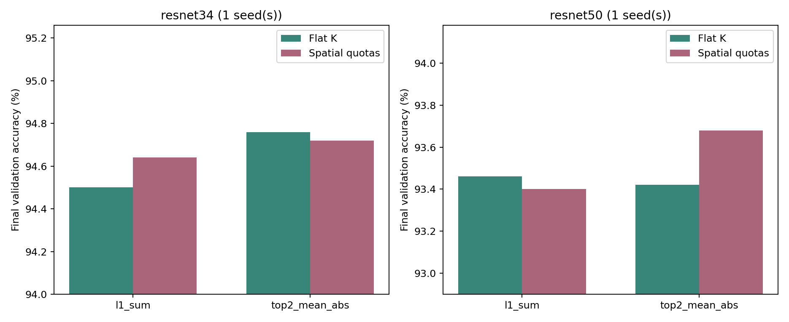
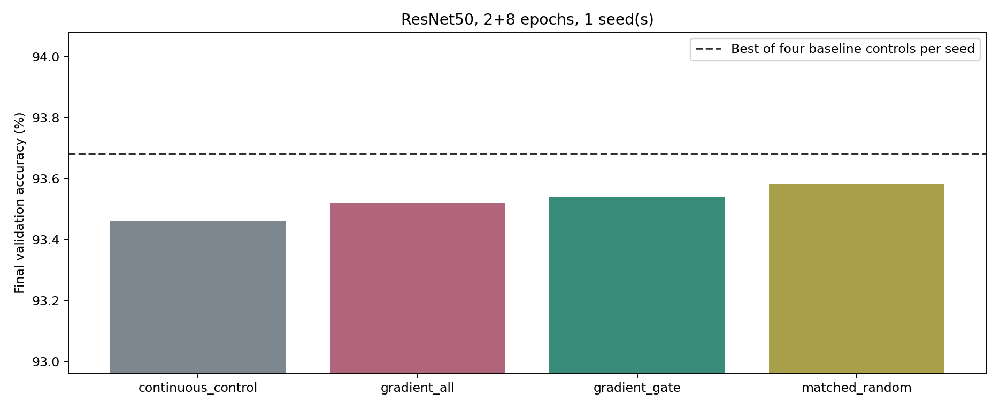

# 2026-11-02：配額基準與適應後梯度搜尋總結

整理：2026-11-02T01:14:11+08:00

本輪完成原文圖示／公式審閱、兩模型8個基準分支，再依預設規則完成ResNet50四個2+8epoch分支。全為seed0 validation，沒有使用test，沒有宣稱統計顯著。

## 第一階段：配額粒度

| Model | Criterion | Flat (%) | Spatial (%) | Spatial-flat (pp) |
|---|---|---:|---:|---:|
| resnet34 | l1_sum | 94.50 | 94.64 | +0.14 |
| resnet34 | top2_mean_abs | 94.76 | 94.72 | -0.04 |
| resnet50 | l1_sum | 93.46 | 93.40 | -0.06 |
| resnet50 | top2_mean_abs | 93.42 | 93.68 | +0.26 |

兩版每cluster總kept_count精確相同，1×1 mask完全相同；flat與既有核心逐元素一致。最大差0.26pp，未達預先0.3pp擴大門檻；不代表兩版本等效。spatial是對原文歧義的操作性解讀，不是已確認作者實作。

本設定的配額粒度差距，不能直接解釋先前與原論文數個百分點的raw accuracy差；模型入口與完整訓練設定等仍未對齊。

## 第二階段：適應後共享Gate梯度

| Method | Validation (%) | 實際交換對數 |
|---|---:|---:|
| continuous_control (seed0) | 93.46 | 0 |
| gradient_all (seed0) | 93.52 | 3261 |
| gradient_gate (seed0) | 93.54 | 144 |
| matched_random (seed0) | 93.58 | 144 |

主方法gradient_gate未超過本輪最佳基準spatial top2的93.68%，也未超過匹配交換數的隨機控制。因此未擴三seed，不從消融挑贏家，不再改交換數或適應epoch。

31項unit tests通過。continuous_control最終state_dict與原10epoch l1逐bit相同；四分支適應2epochs後model、optimizer、AMP scaler及完整RNG相同。三個搜尋分支產生的候選／gate／random plans逐元素相同。配額與資料隔離亦通過。

報表曾有重複seed keyword TypeError，worker完成不受影響；已修正並測試，原controller保留於revisions，SHA與恢復事件記錄完整。沒有模型重跑、OOM或kill。

## 研究判斷

本輪完成了基準審核及一個依結果啟動的新候選機制，但未取得可靠的分類優勢。不能宣稱shared-mask方法無效；也不能把數學正確導數、單seed小提升或較低search CE當作有效論文貢獻。

目前不建議再擴大這個單次梯度交換版本。若下一輪仍追精度，應另立有明確比較預算的權重補償或訓練期mask更新假說，並先比對既有文獻；本輪未啟動未凍結的新實驗。

## 檔案與重現

[原文審核](spatial_quota_baseline_study/PAPER_AUDIT.md)、[基準報告](spatial_quota_baseline_study/BASELINE_REPORT.md)、[梯度報告](adapted_gradient_mask_study/FINAL_REPORT.md)。兩資料夾均有CSV、mask、log、問題紀錄、測試輸出及程式快照。

ZIP包含本總結及兩批證據，不包含CIFAR、Dense checkpoints或大型訓練權重。重跑訓練仍需原repository、資料與checkpoints；本機大型檔案未刪除。
