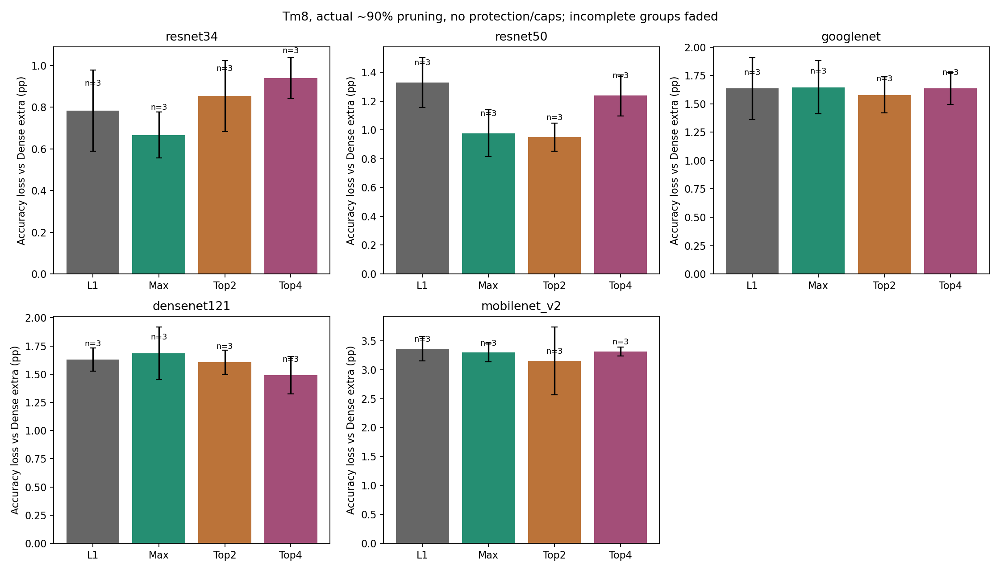
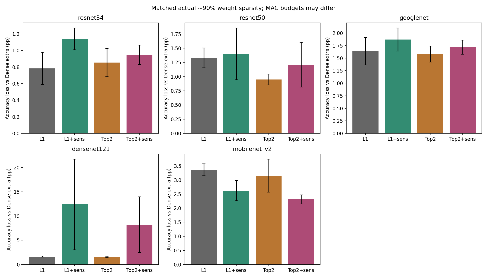

# 實際約90%剪枝：公平比較最終結果

整理時間：2026-10-27T17:48:39+08:00

共完成45個importance比較與30個敏感層重新分配任務；另沿用15組l1_sum基準。Tm8，固定Dense checkpoint，fine-tune10 epochs。

## Importance-only

| Model | Criterion | FT acc (%) | Loss (pp) | Actual sparsity (%) | MAC reduction (%) |
|---|---|---:|---:|---:|---:|
| densenet121 | l1_sum | 93.587 | 1.630 | 90.0013 | 85.181 |
| googlenet | l1_sum | 92.460 | 1.637 | 90.0008 | 74.842 |
| mobilenet_v2 | l1_sum | 81.960 | 3.363 | 89.9948 | 70.950 |
| resnet50 | l1_sum | 92.933 | 1.330 | 90.0006 | 79.892 |
| resnet34 | l1_sum | 94.007 | 0.783 | 90.0002 | 78.507 |
| resnet34 | max_abs | 94.123 | 0.667 | 90.0002 | 78.507 |
| resnet34 | top2_mean_abs | 93.937 | 0.853 | 90.0002 | 78.507 |
| resnet34 | top4_mean_abs | 93.850 | 0.940 | 90.0002 | 78.507 |
| resnet50 | max_abs | 93.287 | 0.977 | 90.0006 | 79.892 |
| resnet50 | top2_mean_abs | 93.313 | 0.950 | 90.0006 | 79.892 |
| resnet50 | top4_mean_abs | 93.023 | 1.240 | 90.0006 | 79.892 |
| googlenet | max_abs | 92.450 | 1.647 | 90.0008 | 74.842 |
| googlenet | top2_mean_abs | 92.517 | 1.580 | 90.0008 | 74.842 |
| googlenet | top4_mean_abs | 92.460 | 1.637 | 90.0008 | 74.842 |
| densenet121 | max_abs | 93.530 | 1.687 | 90.0013 | 85.181 |
| densenet121 | top2_mean_abs | 93.610 | 1.607 | 90.0013 | 85.181 |
| densenet121 | top4_mean_abs | 93.727 | 1.490 | 90.0013 | 85.181 |
| mobilenet_v2 | max_abs | 82.027 | 3.297 | 89.9948 | 70.950 |
| mobilenet_v2 | top2_mean_abs | 82.170 | 3.153 | 89.9948 | 70.950 |
| mobilenet_v2 | top4_mean_abs | 82.010 | 3.313 | 89.9948 | 70.950 |

## Sensitivity + budget redistribution

下表匹配weight sparsity，未匹配MAC budget。此規則是預先固定的heuristic，不保證保護版會提高精度。

| Model | Criterion | Protection | FT acc (%) | Loss (pp) | Actual sparsity (%) | MAC reduction (%) |
|---|---|---|---:|---:|---:|---:|
| densenet121 | l1_sum | none | 93.587 | 1.630 | 90.0013 | 85.181 |
| googlenet | l1_sum | none | 92.460 | 1.637 | 90.0008 | 74.842 |
| mobilenet_v2 | l1_sum | none | 81.960 | 3.363 | 89.9948 | 70.950 |
| resnet50 | l1_sum | none | 92.933 | 1.330 | 90.0006 | 79.892 |
| resnet34 | l1_sum | none | 94.007 | 0.783 | 90.0002 | 78.507 |
| resnet34 | top2_mean_abs | none | 93.937 | 0.853 | 90.0002 | 78.507 |
| resnet50 | top2_mean_abs | none | 93.313 | 0.950 | 90.0006 | 79.892 |
| googlenet | top2_mean_abs | none | 92.517 | 1.580 | 90.0008 | 74.842 |
| densenet121 | top2_mean_abs | none | 93.610 | 1.607 | 90.0013 | 85.181 |
| mobilenet_v2 | top2_mean_abs | none | 82.170 | 3.153 | 89.9948 | 70.950 |
| resnet34 | l1_sum | sensitivity_redistributed | 93.650 | 1.140 | 90.0002 | 77.996 |
| resnet34 | top2_mean_abs | sensitivity_redistributed | 93.843 | 0.947 | 90.0002 | 77.996 |
| resnet50 | l1_sum | sensitivity_redistributed | 92.863 | 1.400 | 90.0006 | 78.987 |
| resnet50 | top2_mean_abs | sensitivity_redistributed | 93.053 | 1.210 | 90.0006 | 78.987 |
| googlenet | l1_sum | sensitivity_redistributed | 92.227 | 1.870 | 90.0008 | 64.757 |
| googlenet | top2_mean_abs | sensitivity_redistributed | 92.380 | 1.717 | 90.0008 | 64.757 |
| densenet121 | l1_sum | sensitivity_redistributed | 82.827 | 12.390 | 90.0013 | 85.933 |
| densenet121 | top2_mean_abs | sensitivity_redistributed | 87.010 | 8.207 | 90.0013 | 85.933 |
| mobilenet_v2 | l1_sum | sensitivity_redistributed | 82.700 | 2.623 | 89.9948 | 68.343 |
| mobilenet_v2 | top2_mean_abs | sensitivity_redistributed | 83.013 | 2.310 | 89.9948 | 68.343 |

原始數據與sample std見兩個資料夾的CSV；gain正值表示改善，必須同時檢查三seed配對差異。圖表為軟體精度實驗，不能推論實測硬體能耗或延遲。
