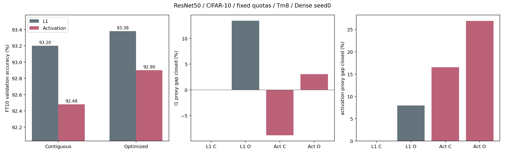

# Activation-aware固定配額分組pilot

完成：2026-11-02T13:43:26+08:00

## 設定

ResNet50/CIFAR-10 seed0、Tm8、同Dense checkpoint、相同逐層q。實際卷積權重稀疏度89.9987%，保留2,345,024 weights及233,504,768 MAC/image。新增兩個FT10分支，重用兩個已完成L1控制。沒有保護、補償、量化或RTL變更，不跑test。

使用Dense eval FP32 forward，在與上輪BN診斷相同的512張train影像上，以每個(c,r,s)的unfold patch RMS建立S=abs(W)*RMS；納入padding/stride，FP64累計。分組與mask皆用同一S。初始groups、4輪交換上限及RNG和L1最佳化相同。

直接重用未修改的fixed_quota_grouping_worker.train，以SGD lr=.001、batch128、AMP float16、10epochs及相同training RNG訓練。BN副本不帶入主FT。固定報第10輪，不挑最好epoch。

## 四格結果

| 方法 | 重用 | FT0 (%) | BN副本 FT0 (%) | FT2 (%) | FT10 (%) |
|---|---|---:|---:|---:|---:|
| l1_contiguous | 是 | 10.06 | 68.02 | 92.78 | 93.20 |
| l1_optimized | 是 | 10.04 | 72.88 | 92.64 | 93.38 |
| activation_contiguous | 否 | 10.04 | 60.10 | 91.58 | 92.48 |
| activation_optimized | 否 | 10.04 | 68.30 | 91.86 | 92.90 |

## 拆解效果

- 固定連續groups，只換score：-0.720pp。
- L1下最佳化groups：+0.180pp。
- Activation score下最佳化groups：+0.420pp。
- 兩個最佳化pipeline之差：-0.480pp；此比較同時改變score及選出的groups，不是固定groups只換mask。
- 探索性interaction：+0.240pp。

只有一個Dense seed，沒有配對std或顯著性證據。validation亦用於其他開發，不當獨立test。activation RMS不是分類loss，也不完整考慮輸入相關性；代理改善不保證accuracy提升。本pilot完成後不自動擴seed或調參。

## 結論

在這個固定配額pilot中，activation-aware連續/最佳化分組分別比對應L1控制低0.72/0.48pp，不支持替換原L1指標。最佳化分組在activation指標內提升0.42pp，但不能只報這個數字，因為最終92.90%仍低於L1連續93.20%及L1最佳化93.38%。目前只有單seed，不將此負結果推論成所有activation-aware或分組方法都無效。完整判斷與下一步界線見[FINDINGS.md](FINDINGS.md)。

## 成本與驗證

統計收集1.25秒，完整準備4.10秒；時間為當下共享GPU環境，不能作獨占speedup。FT seconds只計訓練路徑時間，不包含全部研究開銷。

PRETRAIN_VALIDATION.json/VALIDATION.json檢查source、校正樣本count、reference q、原filter ID mask scatter、score與mask相符、交換目標不增、weight/MAC budget及禁止位置無regrowth。UNIT_TESTS.txt包含padding/stride/dilation與optimizer/resume測試。

## 資料入口

- four_cell_results.csv、effects.json：原始四格結果與效果拆解。
- prepared/seed0/activation_statistics.pt：每層sum/count/RMS。
- prepared/seed0/layer_metrics.csv：四格都以同一L1與activation proxy計算，不直接比較不同單位。
- prepared/seed0/search_history.json、groups/masks：固定搜尋與分組資料。
- reused_controls/：原L1控制的報表、設定、歷史及mask副本。
- seed0_*/：新增兩分支完整訓練狀態及最終模型，僅保留本機。
- study_configuration.json/source_snapshot/：凍結計畫、來源與舊結果checksum。
- EXECUTION_LOG.md/execution.jsonl/logs/：執行與問題紀錄。

## 硬體界線

本輪只評估軟體精度；無cycle-accurate模擬、INT8或實際存取/功耗收益證據。任意filter ID的硬體查表與寫回成本仍需另驗證。
