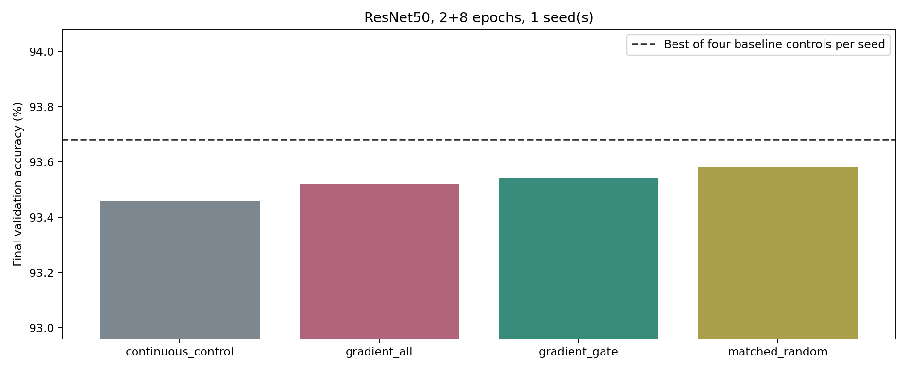

# 適應訓練後的共享Gate梯度：結果

完成：2026-11-02T01:10:39+08:00

固定Dense checkpoint、Tm8、flat共享K、實際約90%權重剪枝，總訓練2+8epochs。保留SGD momentum、AMP scaler及訓練RNG。梯度只用train內新search資料，gate另用check否決；audit不參與決策，test沒有評估。

## 分類結果

| Seed | Method | Validation (%) | vs best of four baseline controls (pp) | Gate exchanges |
|---:|---|---:|---:|---:|
| 0 | continuous_control | 93.460 | -0.220 | 0 |
| 0 | gradient_all | 93.520 | -0.160 | 144 |
| 0 | gradient_gate | 93.540 | -0.140 | 144 |
| 0 | matched_random | 93.580 | -0.100 | 144 |

## 對照與可信度

continuous_control的完整最終state_dict與原10epoch flat l1逐bit相同；各分支2epoch適應後state_dict亦完全一致。三個搜尋分支的候選／gate／隨機plans逐元素相同；只有最後套用的mask不同。VALIDATION.json檢查配額與資料隔離。

比較控制包含本輪flat/spatial的l1/top2，不只與較弱l1比較；baseline_controls.csv列出全部數字。

## 判斷

主方法gradient_gate未同時達成：比四個baseline最高者高0.1pp、且不低於gradient_all與matched_random。因此未擴三seed；沒有改挑消融當成功方法，也沒有試更多交換數或epoch位置。

共享gate梯度可驗證為正確導數，但單次一階近似、stale-gradient與Dense dormant-weight恢復值都可能限制實際分類效果。這些是限制／假說，不是已證實失敗原因。Taylor與梯度再生已有文獻，未宣稱概念原創。

完整方法凍結於source_snapshot計畫。逐層預測與真實CE、交換位置、訓練歷程與問題處理均保存。
