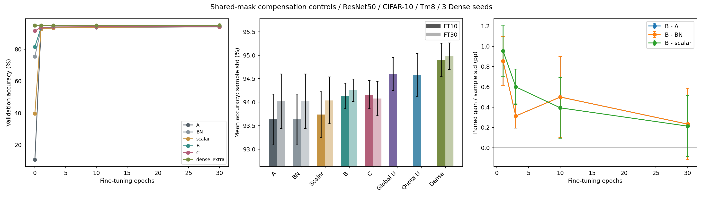

# 共享Mask補償：便宜控制與FT30證據鏈

完成時間：2026-11-05T16:37:08+08:00

## 主要判斷

B ridge在FT10平均優於BN-only及每filter scalar，對scalar為+0.393pp（3/3seeds正值）；FT30增益縮為+0.213pp。對A的FT30提升為+0.233pp，僅2/3seeds為正。支持固定微調預算的初步收益，但不能宣稱收斂後普遍提高精度或統計顯著。C在FT30三seeds均低於B，主線保留較簡單B。完整限制、下一輪與問題處理見[FINDINGS.md](FINDINGS.md)。

## 評估規則

ResNet50/CIFAR-10、Tm8、三個獨立100epoch Dense seeds0/1/2。train45000/val5000，split_seed0；原10000張test曾在早期使用，本輪沒有新test forward。校正fit512/check512為互不重疊train子集。所有數據為validation，不宣稱未見test或統計顯著。

剪53個一般Conv2d，含首層、1x1及downsample，不剪FC/BN。A/BN/scalar/B/C使用每seed完全相同global_cluster flat l1共享mask；實際sparsity與逐層/cluster q見prepared及layers_audit.csv。global U只同總weights；quota U精確同每filter q及MAC。非結構化是參考，不是精度嚴格上界。

## 方法

A原權重；BN只預校正BN running statistics；scalar每filter一純量且check變差則整cluster fallback；B為Dense-input ridge主線；C為student-prefix逐層ridge；Dense為未剪的同預算追加訓練。全部同SGD/AMP及FT RNG，不調lambda、不挑最好epoch。

A/B/C直接重用既有FT0..10並載入完整epoch10狀態續跑11..30。其餘主要分支0..30為同一條軌跡，兩個U控制只跑FT10。長微調使用相同constant lr=.001，沒有重啟optimizer/scaler/RNG。

## 平均結果

以下mean +/- sample std，單位%。

| 方法 | FT0 | FT1 | FT3 | FT10 | FT30 |
|---|---:|---:|---:|---:|---:|
| A | 10.707 +/- 1.000 | 92.707 +/- 0.391 | 93.587 +/- 0.393 | 93.633 +/- 0.541 | 94.020 +/- 0.581 |
| BN | 75.453 +/- 0.516 | 92.707 +/- 0.391 | 93.587 +/- 0.393 | 93.633 +/- 0.541 | 94.020 +/- 0.581 |
| scalar | 39.713 +/- 9.870 | 92.607 +/- 0.404 | 93.300 +/- 0.380 | 93.740 +/- 0.485 | 94.040 +/- 0.498 |
| B | 81.540 +/- 3.526 | 93.560 +/- 0.151 | 93.900 +/- 0.299 | 94.133 +/- 0.270 | 94.253 +/- 0.239 |
| C | 91.467 +/- 0.733 | 93.633 +/- 0.095 | 93.907 +/- 0.376 | 94.160 +/- 0.299 | 94.080 +/- 0.367 |
| dense_extra | 94.833 +/- 0.364 | 94.793 +/- 0.370 | 94.907 +/- 0.372 | 94.900 +/- 0.354 | 94.980 +/- 0.280 |
| global_unstructured | 60.507 +/- 4.434 | 94.480 +/- 0.382 | 94.560 +/- 0.418 | 94.600 +/- 0.352 | N/A |
| quota_unstructured | 15.867 +/- 4.925 | 94.073 +/- 0.380 | 94.307 +/- 0.446 | 94.580 +/- 0.454 | N/A |

## 配對提升

以下同Dense seed逐一相減後平均及sample std，單位pp。

| 方法 | 控制 | FT | Mean gain | Paired std | 正值seeds |
|---|---|---:|---:|---:|---:|
| B | A | 1 | +0.853 | 0.242 | 3/3 |
| B | A | 3 | +0.313 | 0.121 | 3/3 |
| B | A | 10 | +0.500 | 0.399 | 3/3 |
| B | A | 30 | +0.233 | 0.351 | 2/3 |
| B | BN | 1 | +0.853 | 0.242 | 3/3 |
| B | BN | 3 | +0.313 | 0.121 | 3/3 |
| B | BN | 10 | +0.500 | 0.399 | 3/3 |
| B | BN | 30 | +0.233 | 0.351 | 2/3 |
| B | scalar | 1 | +0.953 | 0.253 | 3/3 |
| B | scalar | 3 | +0.600 | 0.174 | 3/3 |
| B | scalar | 10 | +0.393 | 0.300 | 3/3 |
| B | scalar | 30 | +0.213 | 0.300 | 3/3 |
| C | A | 1 | +0.927 | 0.297 | 3/3 |
| C | A | 3 | +0.320 | 0.053 | 3/3 |
| C | A | 10 | +0.527 | 0.293 | 3/3 |
| C | A | 30 | +0.060 | 0.262 | 1/3 |
| C | BN | 1 | +0.927 | 0.297 | 3/3 |
| C | BN | 3 | +0.320 | 0.053 | 3/3 |
| C | BN | 10 | +0.527 | 0.293 | 3/3 |
| C | BN | 30 | +0.060 | 0.262 | 1/3 |
| C | scalar | 1 | +1.027 | 0.311 | 3/3 |
| C | scalar | 3 | +0.607 | 0.140 | 3/3 |
| C | scalar | 10 | +0.420 | 0.203 | 3/3 |
| C | scalar | 30 | +0.040 | 0.271 | 2/3 |

## 下一輪決策

預先5seed投入資格：True。FT10或FT30中B對BN與scalar均平均>=0.2pp，且至少2/3seed同時對兩者為正，才建議下一輪確認。這不是顯著性檢定；本輪未跑5seed、跨模型或80/95%。詳見decision.json。

## 驗證與界線

PRETRAIN_VALIDATION.json檢查fresh core mask、global threshold、逐filter q、scalar解與fallback、BN僅改buffers及actual budgets。VALIDATION.json檢查連續epoch與禁止位置；BN_A_EQUIVALENCE.json另對BN/A epoch10的functional state、optimizer、scaler、RNG逐bit比較，不把num_batches_tracked誤當推論差異。

63項既有及新增測試通過，見UNIT_TESTS.txt。另稽核42個FT10/30 checkpoint，沒有禁止位置非零或保留位置數值為零的差異，見DERIVED_AUDIT.json及numerical_sparsity_audit.csv。來源/資料SHA見sources.json及prepared/configuration.json。既有資料只讀，所有新checkpoint放本資料夾；source_snapshot保存本輪計畫與程式。

## 資料導覽

- validation_long.csv、mean_results.csv、paired_differences.csv：原始軌跡及配對統計。
- prepared/seed*/layers.csv、clusters.csv：所有層與cluster配額。
- prepared/seed*/scalar_reconstruction.csv：alpha、fit/check誤差及fallback。
- seed*/：FT10/30結果、完整resume狀態與最終模型。
- BN_A_EQUIVALENCE.json：BN控制的作用是否在訓練後消失。
- BN_A_PARAMETER_AUDIT.json：三seed參數/optimizer/scaler/RNG相同，但部分BN buffers仍有5.6e-45差異，不宣稱整個state bit-exact。
- gap_decomposition.csv、gap_summary.json：FT10非共享參考差距，非精度數學上界。
- C_vs_B_paired.csv、numerical_sparsity_audit.csv：C/B直接配對與結構/數值稀疏度。
- costs.csv、late_curves.png：離線/訓練成本及不含FT0的放大軌跡。
- EXECUTION_LOG.md、execution.jsonl、logs/：執行與問題處理。

## 成本與研究界線

曲線的epoch不是總成本；FT seconds不含全部teacher cache準備/求解/診斷/排隊。時間為共享GPU環境，不宣稱推論加速。未做新量化、RTL、分組搜尋、activation加權或補償感知mask。Ridge及二階補償有既有文獻，不把概念本身稱原創。

原報表NumPy RNG比較與MKL/OpenMP衝突只影響收尾，已用獨立report-only finalizer修正，未改凍結訓練或重算模型。失敗紀錄UNIT_TESTS_mkl_failure.txt、REPORTING_FIX.json與EXECUTION_LOG.md保留。重建報表使用`env MKL_THREADING_LAYER=GNU OMP_NUM_THREADS=4 MKL_NUM_THREADS=4 OPENBLAS_NUM_THREADS=4 python scripts/finalize_compensation_controls.py`；補做數值稽核使用相同環境執行`scripts/audit_compensation_control_outputs.py`。
