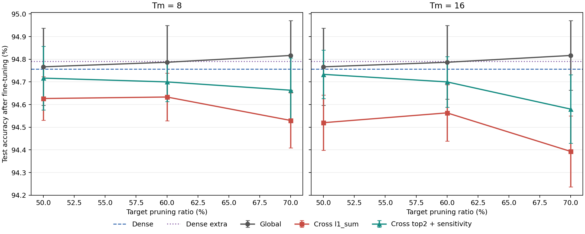
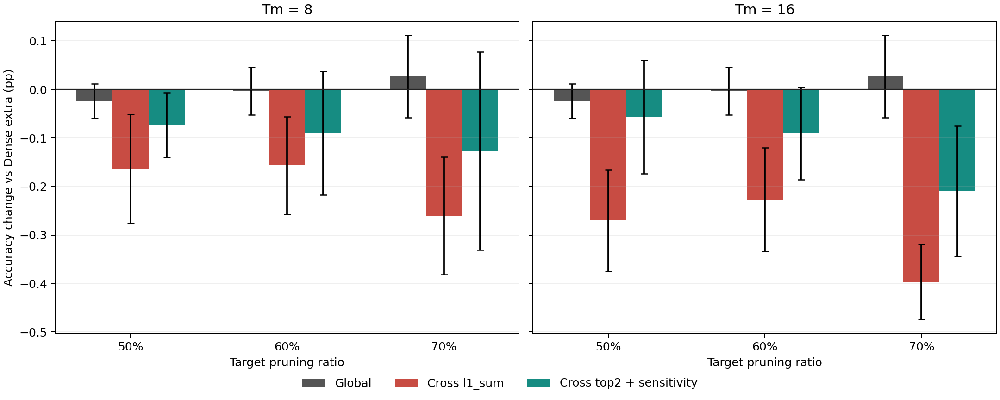
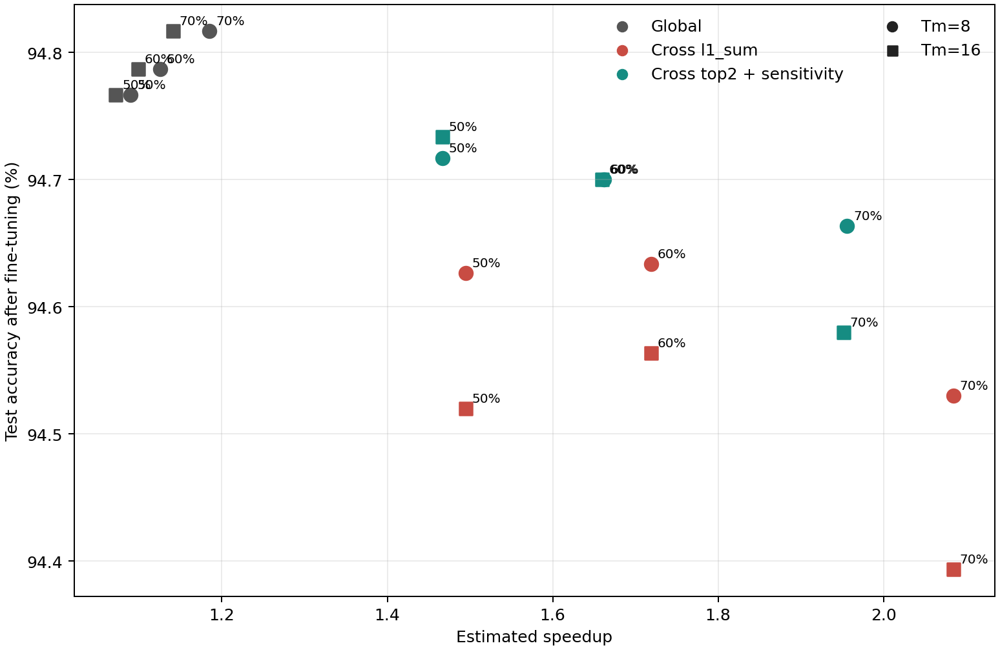

# 固定 Dense checkpoint 的正式剪枝比較

這批實驗解決先前不同 job 各自重訓 Dense、導致 baseline 不一致的問題。所有方法都從同一 seed 的固定 ResNet34 checkpoint 分支，再使用相同資料順序與 fine-tuning 設定比較。

## 實驗設定

- Dataset / model：CIFAR-10 / ResNet34
- Seeds：`0, 1, 2`
- 固定 split ID：`42fbb7440cc27c71`
- Target pruning ratio：`0.5, 0.6, 0.7`
- PE cluster size：`Tm=8, 16`
- Fine-tuning：10 epochs，SGD，LR `0.001`，batch size 128
- Ratio source：`global_cluster`
- Global baseline：global unstructured pruning
- 原始方法：cross-filter `l1_sum`，沒有 sensitivity protection 或 layer cap
- 改良方法：cross-filter `top2_mean_abs`，只對此 criterion 套用 `top_k=4`、`skip_top_k=1`、敏感層 cap `0.2`、全層 cap `0.75`
- 敏感層排名：每個 seed / Tm 各自載入相同固定 Dense checkpoint，只使用 5,000 張 validation images 產生；test set 沒有參與排名

總計完成 `3 seeds × 3 ratios × 2 Tm = 18` 個 run，每個 run 都包含 Dense、Dense extra、Global、`l1_sum` 與 sensitivity-aware `top2`。

## Dense 基準

| Baseline | Test accuracy mean | Sample std |
|---|---:|---:|
| Dense | 94.757% | 0.157 pp |
| Dense extra | 94.790% | 0.205 pp |

Dense extra 只比 Dense 高 0.033 pp，表示目前比較已不再受「pruned model 偷偷多訓練」明顯影響。

## Cross-filter 結果

以下 accuracy 是三個 seed 在 fine-tuning 後的 test mean；括號內是 sample std。

| Tm | Target | `l1_sum` accuracy | 改良 `top2` accuracy | `top2 - l1` | `l1_sum` actual prune | `top2` actual prune |
|---:|---:|---:|---:|---:|---:|---:|
| 8 | 50% | 94.627% (0.096) | 94.717% (0.140) | +0.090 pp | 50.00% | 46.18% |
| 8 | 60% | 94.633% (0.105) | 94.700% (0.087) | +0.067 pp | 60.00% | 54.04% |
| 8 | 70% | 94.530% (0.122) | 94.663% (0.143) | +0.133 pp | 70.00% | 61.32% |
| 16 | 50% | 94.520% (0.122) | 94.733% (0.107) | +0.213 pp | 50.00% | 46.17% |
| 16 | 60% | 94.563% (0.124) | 94.700% (0.111) | +0.137 pp | 60.00% | 53.97% |
| 16 | 70% | 94.393% (0.157) | 94.580% (0.151) | +0.187 pp | 70.00% | 61.24% |

逐 seed 配對結果中，改良 `top2` 在 `18/18` 組都高於 `l1_sum`，沒有平手。不過這不能解讀成 `top2_mean_abs` criterion 單獨必勝，因為 sensitivity protection 讓它的實際剪枝比例低了約 3.8–8.8 pp；這批證明的是「`top2_mean_abs` 加敏感層保護」整體策略能穩定換回 accuracy。

## 硬體指標

- `l1_sum` 保持規則 cross-filter mask，在 target 50/60/70% 時，估算 speedup 約為 `1.50x / 1.72x / 2.08x`。
- 改良 `top2` 因保護敏感層、實際剪得較少，估算 speedup 約為 `1.47x / 1.66x / 1.95x`。
- Global pruning 的 test accuracy 最好，但相同 MAC reduction 下估算 speedup 只有約 `1.07x–1.19x`，反映不規則 workload 造成的 PE imbalance。
- `Tm=16` 的原始 `l1_sum` accuracy 通常低於 `Tm=8`，高 ratio 時差異較明顯；較大的 filter cluster 對共用 mask 限制更強。

## 圖表

## 重要檔案

- `all_results_combined.csv`：18 個 run 的 90 筆完整原始 rows。
- `method_summary_mean_std.csv`：依 method / Tm / ratio 彙整的三 seed mean 與 sample std。
- `paired_top2_vs_l1.csv`：每個 seed 的 `top2` 對 `l1_sum` 配對結果。
- `dense_summary.csv`：固定 Dense 與公平 Dense-extra 摘要。
- `logs/`：每個 run 的完整訓練 log。
- `charts/`：三張正式比較圖。

後續若要拆開驗證「importance criterion」與「sensitivity protection」各自貢獻，需要再補一組相同實際 sparsity 的 `top2_mean_abs` 無保護 ablation，或重新分配其他非敏感層的 pruning ratio，使兩方法達到相同總 sparsity / MAC reduction。
