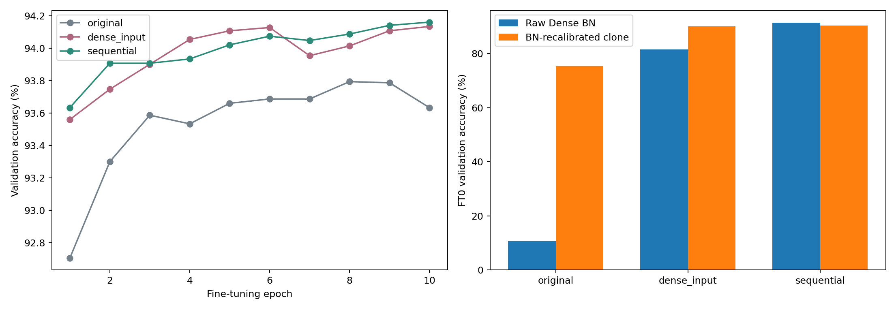

# 固定共享Mask權重補償：結果

更新：2026-11-02T02:00:18+08:00

ResNet50/CIFAR-10、Tm8、flat l1固定共享mask、實際約90%conv-weight sparsity。original不補償，dense_input使用Dense patches重建，sequential使用實際student prefix逐層重建。三分支mask逐bit相同，離線不改BN/bias/分類器。

## Validation結果

| Seed | Variant | FT0 (%) | FT0 BN clone (%) | FT2 (%) | FT10 (%) | FT10 gain vs A (pp) |
|---:|---|---:|---:|---:|---:|---:|
| 0 | original | 10.080 | 74.860 | 93.220 | 93.460 | +0.000 |
| 0 | dense_input | 83.120 | 90.220 | 93.440 | 93.860 | +0.400 |
| 0 | sequential | 91.900 | 91.060 | 93.500 | 93.940 | +0.480 |
| 1 | original | 10.180 | 75.800 | 93.080 | 93.200 | +0.000 |
| 1 | dense_input | 77.500 | 89.800 | 93.740 | 94.140 | +0.940 |
| 1 | sequential | 90.620 | 90.160 | 93.840 | 94.040 | +0.840 |
| 2 | original | 11.860 | 75.700 | 93.600 | 94.240 | +0.000 |
| 2 | dense_input | 84.000 | 90.340 | 94.060 | 94.400 | +0.160 |
| 2 | sequential | 91.880 | 90.140 | 94.380 | 94.500 | +0.260 |

## 決策與限制

seed0通過投入門檻，已對稱補A/B/C三seeds。C相對A的平均差+0.527pp，sample std 0.293pp。這仍是validation確認，不是獨立test或跨模型結論。

check資料參與回退，不能視為獨立泛化證據。Dense與FT使用train，所有分類開發僅看validation；本輪未評估test。BN診斷只在clone執行，沒有改變主FT起點。補償的時間與記憶體是額外離線成本，不能以同epochs宣稱總成本完全相同。

每層fit/check MSE、權重範圍、input偏移與回退數在各分支cluster_reconstruction.csv。q=0保持零，不新增連接。FP64 ridge解先cast回FP32才檢查；未把重建或ridge本身稱為新穎。

## 量化狀態

本報告只有浮點/AMP；oneDNN不視為硬體Q15 bit-exact。若浮點主方法成立，需先核對硬體參考模型覆蓋與相同INT8格式，才進量化，不能把硬體相容性當成已完成。

## 可重現性

完整mask、資料indices、來源hash、校正benchmark、全部epoch、checkpoint及問題紀錄均保留。VALIDATION.json檢查mask/零位/BN/資料隔離；A若有舊控制則要求最終state_dict逐bit相同。

## 三seed與權重補償機制分析

| Variant | Seeds | FT0 mean (%) | BN clone FT0 mean (%) | FT2 mean (%) | FT10 mean (%) | FT10 sample std (pp) |
|---|---:|---:|---:|---:|---:|---:|
| original | 3 | 10.707 | 75.453 | 93.300 | 93.633 | 0.541 |
| dense_input | 3 | 81.540 | 90.120 | 93.747 | 94.133 | 0.270 |
| sequential | 3 | 91.467 | 90.453 | 93.907 | 94.160 | 0.299 |

dense_input_minus_original_pp：平均+0.500pp，配對sample std 0.399pp；逐seed +0.400, +0.940, +0.160pp。

sequential_minus_original_pp：平均+0.527pp，配對sample std 0.293pp；逐seed +0.480, +0.840, +0.260pp。

sequential_minus_dense_input_pp：平均+0.027pp，配對sample std 0.110pp；逐seed +0.080, -0.100, +0.100pp。

C相對A的改善與C是否優於B是兩個問題。即使權重補償整體有效，若C-B不一致或差距很小，也不能把student-prefix逐層版本的額外複雜度當作已成立貢獻。三seed validation仍不能直接當作獨立test、新穎性或跨模型保證。

## INT8相容性待辦

已找到另一個本機專案的Q15 scalar primitives與ResNet34 integer backbone，但已檢查路徑僅兩卷積block，未覆蓋ResNet50 Bottleneck conv3。未修改該專案或RTL，也未用oneDNN替代bit-exact結論；詳INT8_READINESS.json。須先取得或建立經驗證的ResNet50參考，才可做同規約INT8比較。

## 檢查與封裝

UNIT_TESTS.txt保存全測試輸出；VALIDATION.json及CACHE_AUDIT.json檢查相同mask、禁止位置、BN/bias/classifier不變、校正資料隔離與teacher樣本對齊。initial_weight_ranges.csv區分mask計畫保留數與實際數值非零數。

ZIP保留mask、indices、每層/每epoch數據、圖表、全部log與程式快照；不含每seed約2.42GiB的teacher cache、校正images或大型模型權重。這些仍保留本機；重跑需要原repository、CIFAR與Dense checkpoints。
