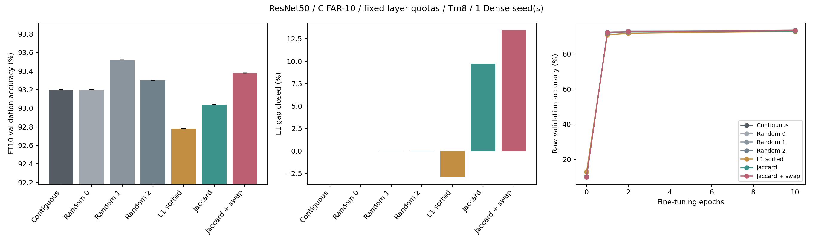

# 固定剪枝量的 Filter 重新分組實驗

完成時間：2026-11-02T10:21:03+08:00

## 設定

ResNet50/CIFAR-10、Tm8、l1_sum、一般卷積含1x1。每seed由global 90% reference取得layer ratio，再固定該層所有cluster的整數q。所有方法同seed的weight/MAC budget相同；不是舊global_cluster配額，不能將舊accuracy當本輪控制。無保護、補償、量化或RTL變更。只評估5000張validation，沒有跑test。

每個方法都以原始Dense checkpoint初始化；FT10相同SGD/AMP/訓練RNG。FT0 BN欄是512張train images校正的獨立副本，不帶入主訓練。代理代價與分類loss不同；缺口閉合率的下界僅指固定每filter q的獨立top-q。

## 結果

| 方法 | Seeds | FT0 (%) | FT0 BN副本 (%) | FT2 (%) | FT10 (%) | 對連續分組提升 (pp) | 配對std (pp) | L1缺口閉合 (%) |
|---|---:|---:|---:|---:|---:|---:|---:|---:|
| contiguous | 1 | 10.060 | 68.020 | 92.780 | 93.200 | +0.000 | N/A | 0.00 |
| random0 | 1 | 10.080 | 65.820 | 92.960 | 93.200 | +0.000 | N/A | -0.03 |
| random1 | 1 | 10.120 | 70.240 | 92.600 | 93.520 | +0.320 | N/A | 0.04 |
| random2 | 1 | 10.140 | 70.140 | 92.420 | 93.300 | +0.100 | N/A | 0.02 |
| norm_sorted | 1 | 12.920 | 52.980 | 91.740 | 92.780 | -0.420 | N/A | -2.91 |
| jaccard | 1 | 10.160 | 72.180 | 92.540 | 93.040 | -0.160 | N/A | 9.74 |
| jaccard_swap | 1 | 10.040 | 72.880 | 92.640 | 93.380 | +0.180 | N/A | 13.47 |

## 決策與界線

交換搜尋版未達預先擴展條件，完成seed0可行性檢查後停止，不調參追高。

seed0預先指定擴展門檻：swap-contiguous >=0.3pp，且swap不低於Jaccard及L1排序。實際seed0差值為+0.180pp。此為投入門檻，不是顯著性檢定。

3個random初始化不等於3個獨立Dense seeds；分開見random_initialization_summary.csv。單seed不可推論普遍優勢；即使多seed為正，也未經獨立test確認，且本validation曾用於其他方法開發。

## 資料導覽

- validation_results.csv：各分支FT0/1/2/10、實際稀疏度、權重/MAC預算、時間與GPU記憶體。
- paired_summary.csv：相同Dense seed配對的平均與sample std。
- layer_metrics_combined.csv：每層q、代理代價、下界與缺口閉合率。
- cluster_metadata.csv：每組filter IDs與kept_count。
- prepared/：原始groups、共享masks、搜尋歷程與BN train indices。
- seed*/：初始診斷、各epoch紀錄、最終模型及完整resume狀態。
- source_snapshot/、sources.json、VALIDATION.json、UNIT_TESTS.txt：計畫、來源與驗證證據。

## 硬體界線

本輪沒有cycle-accurate OS模擬，沒有宣稱非連續filter ID的查表/寫回零成本，也沒有宣稱真實speedup。不同cluster順序執行不直接等於負載不平衡浪費。

## 執行紀錄

GPU原有負載約97-99%，每卡只新增一個worker，不動既有工作。時間包含共享GPU競爭，不能視為獨占benchmark。詳見EXECUTION_LOG.md、execution.jsonl與logs/。
