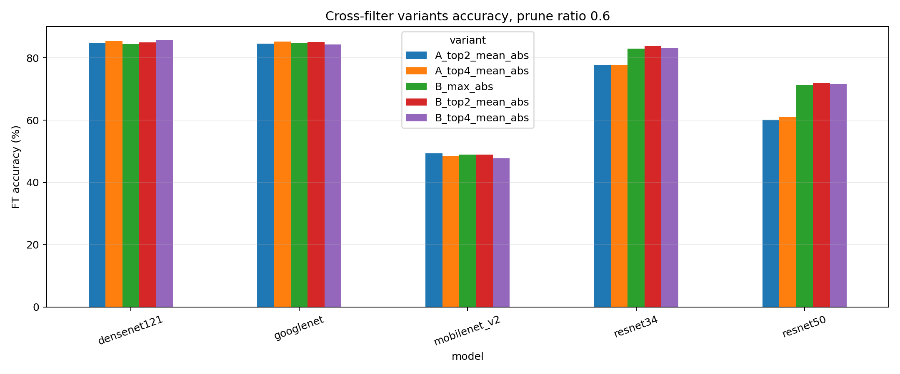
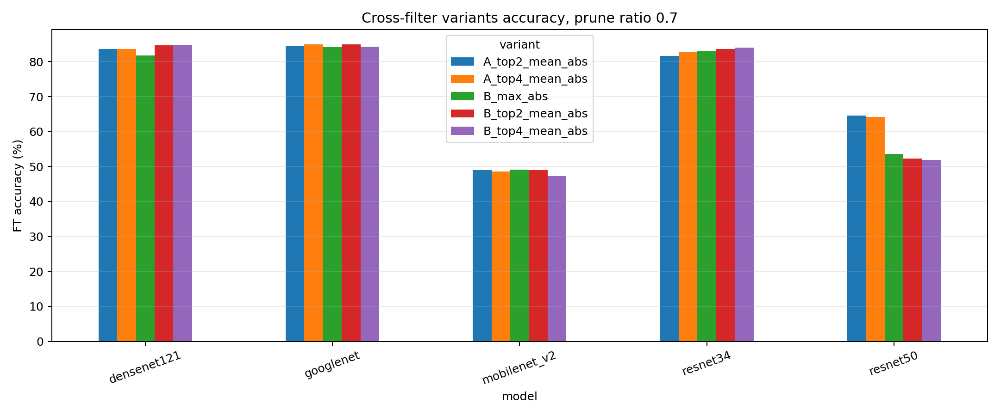
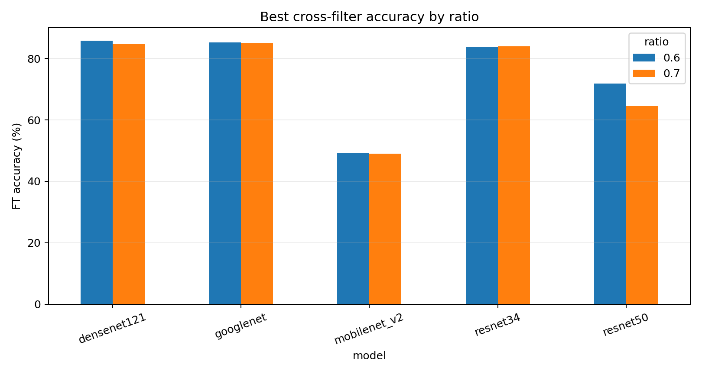

# top-k 與 protected/cap 實驗結果

這個資料夾整理的是 CIFAR-10 多模型改良方法實驗，已完成 `r0p6` 與 `r0p7`。主要比較兩組方法：

- A：`top2_mean_abs` / `top4_mean_abs`，保留原本 layer sparsity 來源。
- B：`max_abs` / `top2_mean_abs` / `top4_mean_abs`，再加 early-layer protected 與 layer-wise ratio cap。

## 資料夾結構

- `summaries/`：最後整理用的總表。優先看這裡。
- `summaries/legacy_r0p6_only/`：舊版只含 `r0p6` 的中間總表，保留作追溯。
- `per_run_csv/r0p6/`：每個 model/variant 在 `prune-ratio 0.6` 的原始輸出 CSV。
- `per_run_csv/r0p7/`：每個 model/variant 在 `prune-ratio 0.7` 的原始輸出 CSV。
- `charts/`：目前產出的比較圖。
- `logs/successful/r0p6/`：`r0p6` 成功執行 log。
- `logs/successful/r0p7_rerun_gpu1/`：`r0p7` 後來在 GPU1 queue 補跑成功的 log。
- `logs/failed/gpu0_r0p7_oom/`：第一次丟 GPU0 的 `r0p7` OOM log，不納入結果。
- `scripts/`：當時用來丟 job 的啟動腳本。

## 主要檔案

- `summaries/all_r0p6_r0p7_results_combined.csv`：`r0p6/r0p7` 全部成功結果合併。
- `summaries/variant_summary_r0p6_r0p7.csv`：每個 cross-filter variant 與同 run dense/global 對照。
- `summaries/best_cross_summary_r0p6_r0p7.csv`：每個 ratio/model 最佳 cross-filter variant。

## 每個 ratio/model 最佳 cross-filter

```text
 ratio        model         variant  acc_pct  delta_vs_dense_extra_pp  delta_vs_global_pp  estimated_speedup
   0.6  densenet121 B_top4_mean_abs    85.82                    -1.96               -2.32           2.157372
   0.6    googlenet A_top4_mean_abs    85.22                     1.33                0.86           1.776238
   0.6 mobilenet_v2 A_top2_mean_abs    49.34                    -0.02                0.41           2.249486
   0.6     resnet34 B_top2_mean_abs    83.86                     1.11               -0.09           1.812442
   0.6     resnet50 B_top2_mean_abs    71.90                    -0.59               -0.26           1.700198
   0.7  densenet121 B_top4_mean_abs    84.78                    -3.00               -3.18           2.677767
   0.7    googlenet A_top4_mean_abs    84.98                     1.09                0.50           2.087485
   0.7 mobilenet_v2       B_max_abs    49.06                    -0.30                0.58           2.454087
   0.7     resnet34 B_top4_mean_abs    84.00                    -0.28               -0.40           2.110420
   0.7     resnet50 A_top2_mean_abs    64.55                    -0.71                0.52           2.038851
```

## 圖表







## 目前解讀

- `top4_mean_abs` 在 GoogLeNet 最穩，`r0p6/r0p7` 都比 dense extra training 與 global pruning 好。
- ResNet34 在 `r0p6` 用 protected/cap 的 `top2_mean_abs` 最好；`r0p7` 則是 protected/cap 的 `top4_mean_abs` 最好。
- DenseNet121 即使有 protected/cap，accuracy 仍掉比較多，可能跟大量 `1x1` convolution 被剪有關。
- MobileNetV2 accuracy 本身偏低，但 cross-filter 相對 global pruning 沒有輸，後續若要分析 depthwise/pointwise conv 要另外切。

## 後續建議

下一步不要全部方法都補 seed。建議只挑每個模型或整體平均較好的 variant，例如 `A_top4_mean_abs`、`B_top2_mean_abs`、`B_top4_mean_abs`，再補 3 個 seed 做穩定性檢查。
