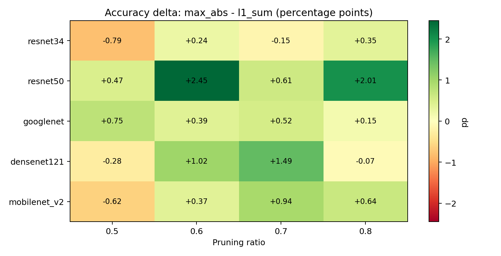
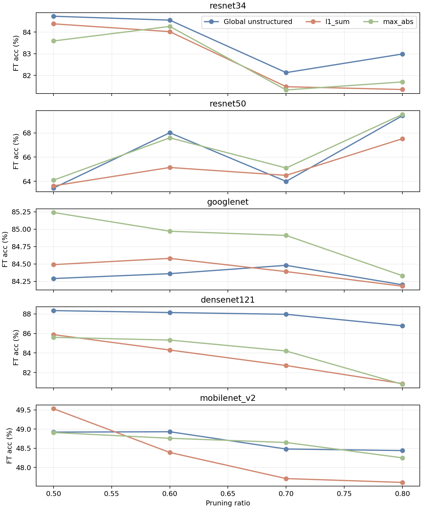
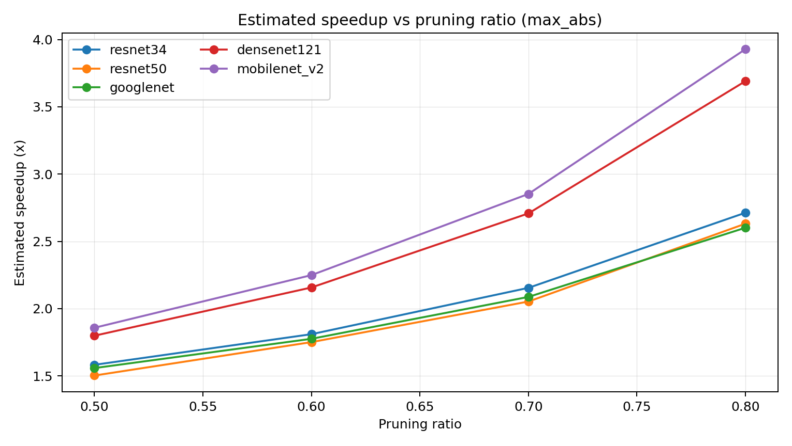
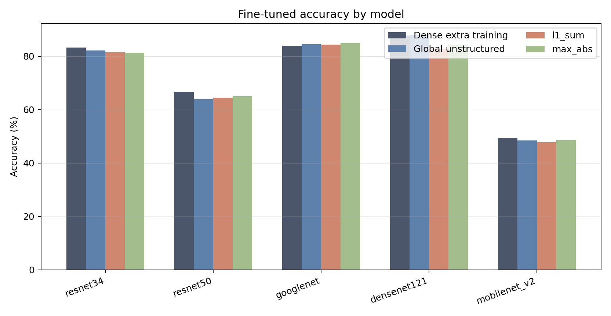

# 圖表說明

- Cross-filter `max_abs - l1_sum` 平均差：`+0.52` percentage points。
- 配對數量：`20` 組 model/ratio。
- `ratio_delta_heatmap.png`：不同 model/ratio 下，`max_abs` 相對 `l1_sum` 的 accuracy 差。
  
- `accuracy_vs_ratio.png`：剪枝比例提高時，各方法 fine-tuned accuracy 的變化。
  
- `speedup_vs_ratio_max_abs.png`：`max_abs` 的估計加速比趨勢。
  
- `model_accuracy_bars_r0p7.png`：各模型在同一設定下的 accuracy 條狀比較。
  
