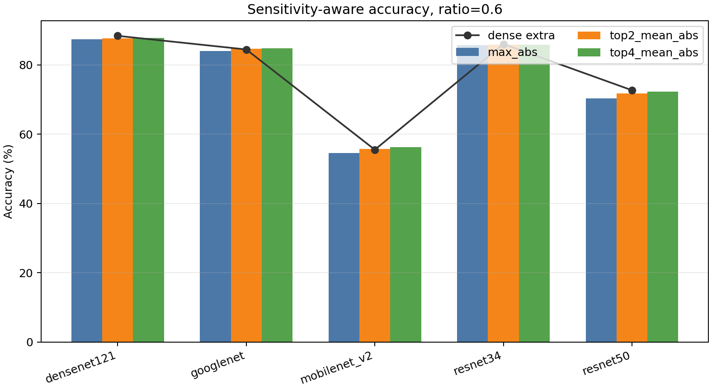
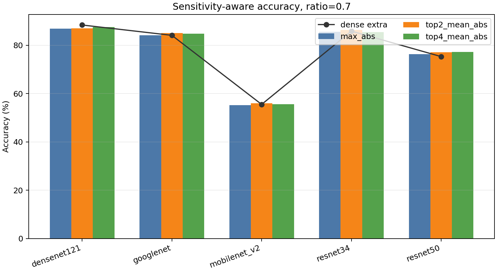
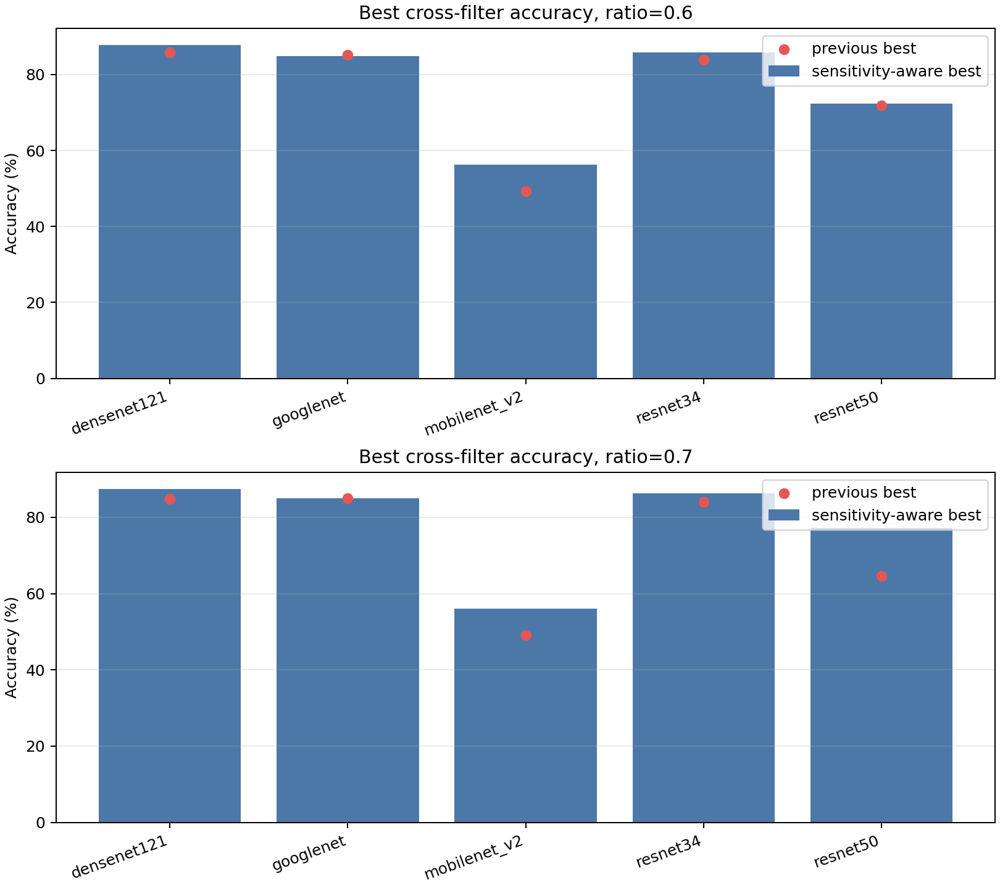
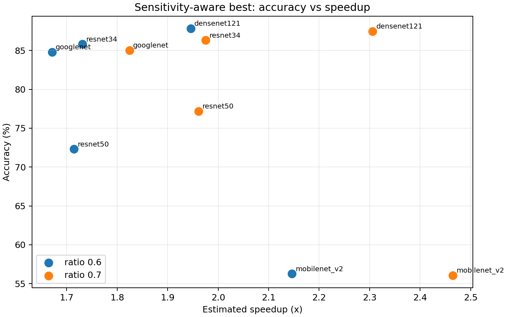

# Sensitivity-aware top-k/protected-cap 實驗

這組實驗使用 `runs/layer_sensitivity_summary/layer_sensitivity_ranked.csv` 來保護敏感層：每個 model/criterion 取最敏感前 4 層，第 1 層不剪，其餘 3 層最多剪 20%。其他層仍照 `global_cluster` sparsity reference，並保留 `--max-layer-prune-ratio 0.75`。

## 設定

- dataset: CIFAR-10
- models: ResNet34、ResNet50、GoogLeNet、DenseNet121、MobileNetV2
- ratios: 0.6、0.7
- criteria: `max_abs`、`top2_mean_abs`、`top4_mean_abs`
- sensitivity protection: `top_k=4`、`skip_top_k=1`、`cap=0.2`
- batch size: 64
- epochs: 5
- fine-tune epochs: 2

## 主要檔案

- `all_sensitivity_aware_results_combined.csv`: 全部原始結果合併。
- `variant_summary.csv`: 每個 variant 對 dense extra/global 的差距。
- `best_sensitivity_aware_summary.csv`: 每個 model/ratio 最佳 sensitivity-aware cross-filter。
- `comparison_vs_previous_best.csv`: 對照前一版 top-k/protected-cap 最佳結果。
- `charts/`: 圖表。

## 每個 model/ratio 最佳結果

```text
target_ratio        model            variant acc_pct delta_vs_dense_extra_pp delta_vs_global_pp actual_pruning_pct mac_reduction_pct speedup
         0.6  densenet121 sens_top4_mean_abs   87.85                   -0.56              -1.15              56.16             48.62    1.95
         0.6    googlenet sens_top4_mean_abs   84.81                   +0.33              -0.11              58.57             40.15    1.67
         0.6 mobilenet_v2 sens_top4_mean_abs   56.26                   +0.73              +0.75              57.95             37.05    2.15
         0.6     resnet34 sens_top2_mean_abs   85.83                   -0.22              -0.28              59.91             42.23    1.73
         0.6     resnet50 sens_top4_mean_abs   72.31                   -0.39              +0.42              58.00             41.67    1.71
         0.7  densenet121 sens_top4_mean_abs   87.49                   -0.92              -1.26              64.03             56.63    2.31
         0.7    googlenet sens_top2_mean_abs   85.04                   +0.91              +0.64              64.34             45.19    1.82
         0.7 mobilenet_v2 sens_top2_mean_abs   56.05                   +0.52              +0.22              64.22             43.34    2.46
         0.7     resnet34 sens_top2_mean_abs   86.32                   +0.45              +0.02              66.96             49.37    1.98
         0.7     resnet50 sens_top4_mean_abs   77.19                   +1.86              +0.82              64.97             49.02    1.96
```

## 與前一版最佳結果比較

正值代表 sensitivity-aware 較好。

```text
target_ratio        model            variant acc_pct    prev_variant prev_acc_pct sens_minus_prev_best_pp speedup prev_speedup
         0.6  densenet121 sens_top4_mean_abs   87.85 B_top4_mean_abs        85.82                   +2.03    1.95         2.16
         0.6    googlenet sens_top4_mean_abs   84.81 A_top4_mean_abs        85.22                   -0.41    1.67         1.78
         0.6 mobilenet_v2 sens_top4_mean_abs   56.26 A_top2_mean_abs        49.34                   +6.92    2.15         2.25
         0.6     resnet34 sens_top2_mean_abs   85.83 B_top2_mean_abs        83.86                   +1.97    1.73         1.81
         0.6     resnet50 sens_top4_mean_abs   72.31 B_top2_mean_abs        71.90                   +0.41    1.71         1.70
         0.7  densenet121 sens_top4_mean_abs   87.49 B_top4_mean_abs        84.78                   +2.71    2.31         2.68
         0.7    googlenet sens_top2_mean_abs   85.04 A_top4_mean_abs        84.98                   +0.06    1.82         2.09
         0.7 mobilenet_v2 sens_top2_mean_abs   56.05       B_max_abs        49.06                   +6.99    2.46         2.45
         0.7     resnet34 sens_top2_mean_abs   86.32 B_top4_mean_abs        84.00                   +2.32    1.98         2.11
         0.7     resnet50 sens_top4_mean_abs   77.19 A_top2_mean_abs        64.55                  +12.64    1.96         2.04
```

## 圖表









## 備註

前面嘗試多 job 並行時 GPU1 受其他大型 job 影響，部分 job 被系統 kill；最後改成單模型順序跑，這裡的 10 個 CSV 都是完整成功輸出。
