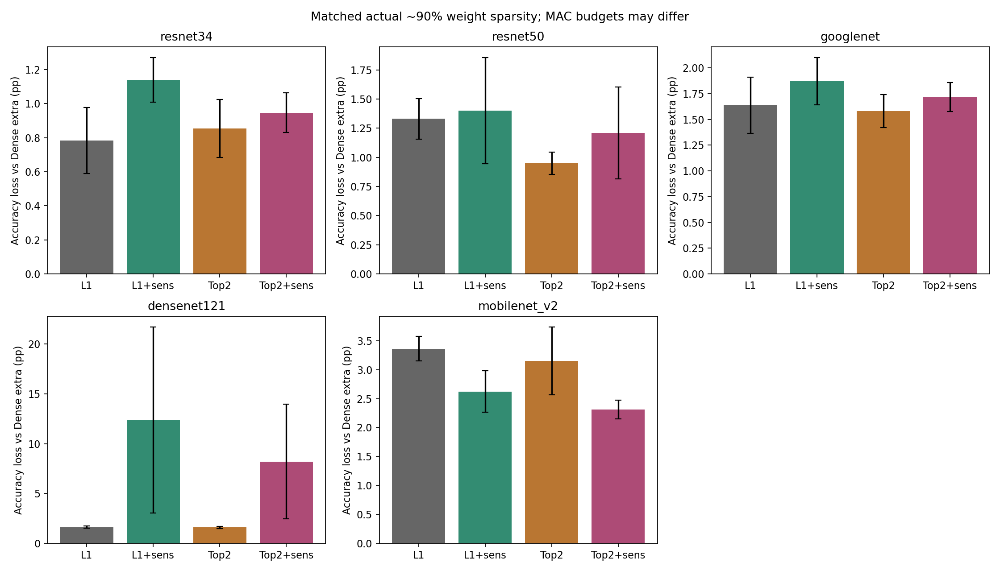

# Matched-Budget Results

Incomplete groups are marked by seed count. Loss is relative to the paired Dense extra; speed is not measured.

| Model | Criterion | Protection | Seeds | FT accuracy (%) | Loss (pp) | Actual sparsity (%) | MAC reduction (%) |
|---|---|---|---:|---:|---:|---:|---:|
| densenet121 | l1_sum | none | 3 | 93.587 | 1.630 | 90.0013 | 85.181 |
| googlenet | l1_sum | none | 3 | 92.460 | 1.637 | 90.0008 | 74.842 |
| mobilenet_v2 | l1_sum | none | 3 | 81.960 | 3.363 | 89.9948 | 70.950 |
| resnet50 | l1_sum | none | 3 | 92.933 | 1.330 | 90.0006 | 79.892 |
| resnet34 | l1_sum | none | 3 | 94.007 | 0.783 | 90.0002 | 78.507 |
| resnet34 | top2_mean_abs | none | 3 | 93.937 | 0.853 | 90.0002 | 78.507 |
| resnet50 | top2_mean_abs | none | 3 | 93.313 | 0.950 | 90.0006 | 79.892 |
| googlenet | top2_mean_abs | none | 3 | 92.517 | 1.580 | 90.0008 | 74.842 |
| densenet121 | top2_mean_abs | none | 3 | 93.610 | 1.607 | 90.0013 | 85.181 |
| mobilenet_v2 | top2_mean_abs | none | 3 | 82.170 | 3.153 | 89.9948 | 70.950 |
| resnet34 | l1_sum | sensitivity_redistributed | 3 | 93.650 | 1.140 | 90.0002 | 77.996 |
| resnet34 | top2_mean_abs | sensitivity_redistributed | 3 | 93.843 | 0.947 | 90.0002 | 77.996 |
| resnet50 | l1_sum | sensitivity_redistributed | 3 | 92.863 | 1.400 | 90.0006 | 78.987 |
| resnet50 | top2_mean_abs | sensitivity_redistributed | 3 | 93.053 | 1.210 | 90.0006 | 78.987 |
| googlenet | l1_sum | sensitivity_redistributed | 3 | 92.227 | 1.870 | 90.0008 | 64.757 |
| googlenet | top2_mean_abs | sensitivity_redistributed | 3 | 92.380 | 1.717 | 90.0008 | 64.757 |
| densenet121 | l1_sum | sensitivity_redistributed | 3 | 82.827 | 12.390 | 90.0013 | 85.933 |
| densenet121 | top2_mean_abs | sensitivity_redistributed | 3 | 87.010 | 8.207 | 90.0013 | 85.933 |
| mobilenet_v2 | l1_sum | sensitivity_redistributed | 3 | 82.700 | 2.623 | 89.9948 | 68.343 |
| mobilenet_v2 | top2_mean_abs | sensitivity_redistributed | 3 | 83.013 | 2.310 | 89.9948 | 68.343 |

