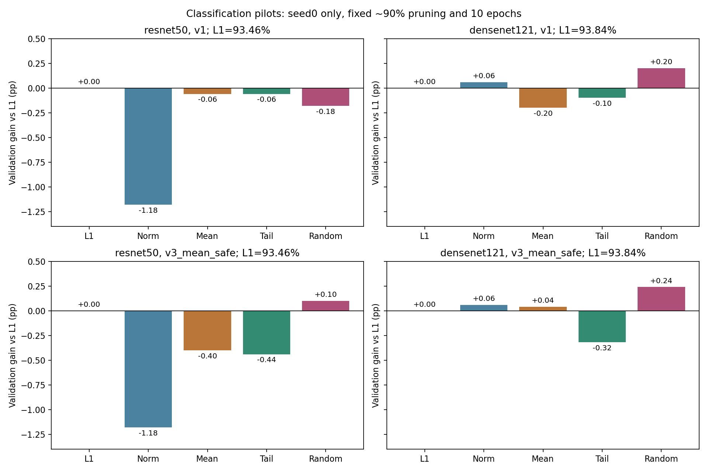
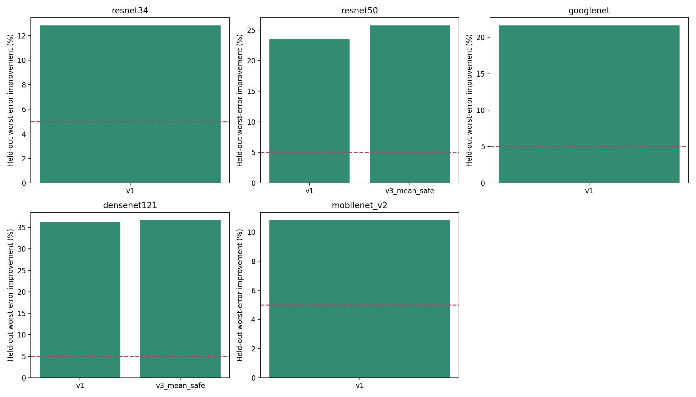

# 固定配額共享Mask修補：結果與問題處理

整理：2026-11-01T23:54:27+08:00

## 實驗限制

固定Tm8、逐cluster kept_count、實際約90%權重剪枝、固定Dense checkpoints。每個訓練分支fine-tune10 epochs。校正資料來自train，設定調整只用校正／validation。

v1是最多8輪的最壞誤差修補；v3_mean_safe先8輪平均、再8輪受限尾端修補，mean對照為16輪。兩版本不可混稱同一方法。

## 五模型seed0診斷

| Model | 最壞誤差改善 (%) | 平均相對誤差變化 (%) | Gate |
|---|---:|---:|---|
| densenet121 | 36.251 | -16.979 | True |
| resnet34 | 12.839 | -4.711 | True |
| googlenet | 21.638 | -8.127 | True |
| resnet50 | 23.494 | -9.792 | True |
| mobilenet_v2 | 10.809 | -3.796 | True |

## Validation消融

這些結果包含開發選擇；不能把單seed validation改善當成獨立test或三seed結論。

| Version | Model | Seed | Variant | Validation accuracy (%) | 相對同seed l1提升 (pp) |
|---|---|---:|---|---:|---:|
| v3_mean_safe | densenet121 | 0 | l1 | 93.840 | +0.000 |
| v3_mean_safe | densenet121 | 0 | mean_repair | 93.880 | +0.040 |
| v3_mean_safe | densenet121 | 0 | normalized | 93.900 | +0.060 |
| v3_mean_safe | densenet121 | 0 | random | 94.080 | +0.240 |
| v3_mean_safe | densenet121 | 0 | worst_repair | 93.520 | -0.320 |
| v3_mean_safe | resnet50 | 0 | l1 | 93.460 | +0.000 |
| v3_mean_safe | resnet50 | 0 | mean_repair | 93.060 | -0.400 |
| v3_mean_safe | resnet50 | 0 | normalized | 92.280 | -1.180 |
| v3_mean_safe | resnet50 | 0 | random | 93.560 | +0.100 |
| v3_mean_safe | resnet50 | 0 | worst_repair | 93.020 | -0.440 |
| v1 | densenet121 | 0 | l1 | 93.840 | +0.000 |
| v1 | densenet121 | 0 | mean_repair | 93.640 | -0.200 |
| v1 | densenet121 | 0 | normalized | 93.900 | +0.060 |
| v1 | densenet121 | 0 | random | 94.040 | +0.200 |
| v1 | densenet121 | 0 | worst_repair | 93.740 | -0.100 |
| v1 | resnet50 | 0 | l1 | 93.460 | +0.000 |
| v1 | resnet50 | 0 | mean_repair | 93.400 | -0.060 |
| v1 | resnet50 | 0 | normalized | 92.280 | -1.180 |
| v1 | resnet50 | 0 | random | 93.280 | -0.180 |
| v1 | resnet50 | 0 | worst_repair | 93.400 | -0.060 |

## 本輪研究結論

固定配額交換可在五模型降低獨立檢查重建誤差，但兩個seed0分類pilot均未支持所提尾端修補方法優於l1。收緊平均誤差約束的mean-safe版本仍未帶來分類優勢，因此未擴大三seed，也未讀取test accuracy。

這是目前設定下未取得支持的初步負結果，不是證明所有mask修補都無效。兩模型、單seed的validation差距不能宣稱統計顯著或普遍劣於原方法。

實際完成7個模型／版本診斷及16個新fine-tune分支，另有4個逐元素相同mask的控制結果復用。隨機交換控制在DenseNet121反而較高，更不宜只憑小幅單seed差異宣稱新importance有效。

## 本輪停止條件

本輪未進入test確認。若候選未通過validation對l1與mean對照的條件，就保留負結果，避免在test上繼續尋找有利設定。

## 已確認與尚未確認

- 校正重建誤差與分類accuracy是不同指標，不能由前者改善直接宣稱分類有效。
- 所有版本及負結果均保留；共同保留數、資料隔離與mask hash檢查見VALIDATION.json。
- 本輪未更改原始硬體資料格式；相同MAC並不保證相同memory-bank行為或量測energy。
- 學術新穎性仍須深入文獻比對；本實驗只提供機制及分類效果證據。

## 問題、解法與重現

詳細過程見EXECUTION_LOG.md及execution.jsonl；各cluster指標、交換位置與設定在v*/<model>_seed*/。

ZIP包含mask、數據、圖表與程式快照，不包含大型校正patches、完整訓練權重或CIFAR資料。這些大型檔案仍在本機。

