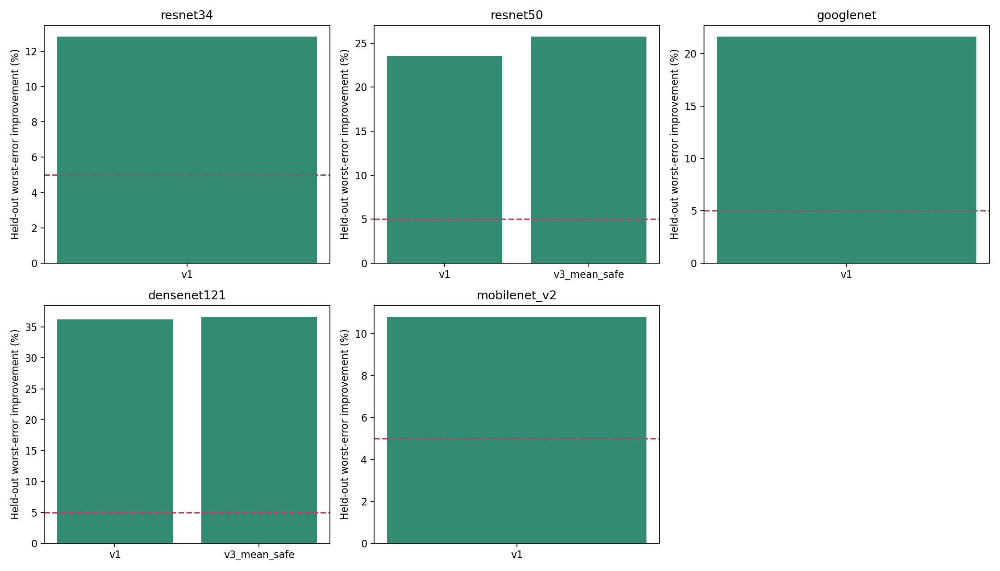

# Shared-Mask Repair Study

Updated: 2026-11-01T23:51:00+08:00

Fixed per-cluster Tm8 kept counts, actual ~90% sparsity. Calibration patches are sampled from train; no test accuracy is used for adjustments.

## Diagnostics

| Version | Model | Variant | Held-out worst error improvement (%) | Held-out mean error increase (%) | Gate |
|---|---|---|---:|---:|---|
| v1 | resnet50 | l1 | 0.000 | 0.000 | False |
| v1 | resnet50 | l1_tm16 | -7.325 | 1.493 | False |
| v1 | resnet50 | mean_repair | 19.593 | -13.611 | True |
| v1 | resnet50 | normalized | 7.539 | -6.661 | True |
| v1 | resnet50 | random | -4.869 | 7.354 | False |
| v1 | resnet50 | worst_repair | 23.494 | -9.792 | True |
| v1 | densenet121 | l1 | 0.000 | 0.000 | False |
| v1 | densenet121 | l1_tm16 | -9.543 | 1.631 | False |
| v1 | densenet121 | mean_repair | 30.713 | -22.887 | True |
| v1 | densenet121 | normalized | 11.501 | -10.500 | True |
| v1 | densenet121 | random | -16.276 | 20.758 | False |
| v1 | densenet121 | worst_repair | 36.251 | -16.979 | True |
| v1 | resnet34 | l1 | 0.000 | 0.000 | False |
| v1 | resnet34 | l1_tm16 | -5.932 | 0.784 | False |
| v1 | resnet34 | mean_repair | 9.807 | -6.778 | True |
| v1 | resnet34 | normalized | 4.774 | -5.241 | False |
| v1 | resnet34 | random | -1.434 | 2.623 | False |
| v1 | resnet34 | worst_repair | 12.839 | -4.711 | True |
| v1 | googlenet | l1 | 0.000 | 0.000 | False |
| v1 | googlenet | l1_tm16 | -9.496 | 2.223 | False |
| v1 | googlenet | mean_repair | 17.865 | -10.937 | True |
| v1 | googlenet | normalized | 1.622 | -2.646 | False |
| v1 | googlenet | random | -4.142 | 5.448 | False |
| v1 | googlenet | worst_repair | 21.638 | -8.127 | True |
| v1 | mobilenet_v2 | l1 | 0.000 | 0.000 | False |
| v1 | mobilenet_v2 | l1_tm16 | -8.289 | 2.340 | False |
| v1 | mobilenet_v2 | mean_repair | 8.738 | -5.782 | True |
| v1 | mobilenet_v2 | normalized | 3.658 | -3.622 | False |
| v1 | mobilenet_v2 | random | -2.719 | 4.143 | False |
| v1 | mobilenet_v2 | worst_repair | 10.809 | -3.796 | True |
| v3_mean_safe | resnet50 | l1 | 0.000 | 0.000 | False |
| v3_mean_safe | resnet50 | l1_tm16 | -7.325 | 1.493 | False |
| v3_mean_safe | resnet50 | mean_repair | 22.858 | -16.262 | True |
| v3_mean_safe | resnet50 | normalized | 7.539 | -6.661 | True |
| v3_mean_safe | resnet50 | random | -6.405 | 10.235 | False |
| v3_mean_safe | resnet50 | worst_repair | 25.751 | -15.013 | True |
| v3_mean_safe | densenet121 | l1 | 0.000 | 0.000 | False |
| v3_mean_safe | densenet121 | l1_tm16 | -9.543 | 1.631 | False |
| v3_mean_safe | densenet121 | mean_repair | 33.569 | -25.985 | True |
| v3_mean_safe | densenet121 | normalized | 11.501 | -10.500 | True |
| v3_mean_safe | densenet121 | random | -19.066 | 25.485 | False |
| v3_mean_safe | densenet121 | worst_repair | 36.664 | -24.401 | True |

## Validation-only fine-tuning

These are exploratory validation results, not final test or three-seed claims.

| Version | Model | Seed | Variant | Direct validation (%) | Final validation (%) |
|---|---|---:|---|---:|---:|
| v1 | resnet50 | 0 | l1 | 10.080 | 93.460 |
| v1 | resnet50 | 0 | mean_repair | 12.660 | 93.400 |
| v1 | resnet50 | 0 | normalized | 14.280 | 92.280 |
| v1 | resnet50 | 0 | random | 10.040 | 93.280 |
| v1 | resnet50 | 0 | worst_repair | 10.920 | 93.400 |
| v1 | densenet121 | 0 | l1 | 10.380 | 93.840 |
| v1 | densenet121 | 0 | mean_repair | 9.400 | 93.640 |
| v1 | densenet121 | 0 | normalized | 9.400 | 93.900 |
| v1 | densenet121 | 0 | random | 9.400 | 94.040 |
| v1 | densenet121 | 0 | worst_repair | 9.400 | 93.740 |
| v3_mean_safe | resnet50 | 0 | l1 | 10.080 | 93.460 |
| v3_mean_safe | resnet50 | 0 | mean_repair | 13.900 | 93.060 |
| v3_mean_safe | resnet50 | 0 | normalized | 14.280 | 92.280 |
| v3_mean_safe | resnet50 | 0 | random | 10.040 | 93.560 |
| v3_mean_safe | resnet50 | 0 | worst_repair | 11.480 | 93.020 |
| v3_mean_safe | densenet121 | 0 | l1 | 10.380 | 93.840 |
| v3_mean_safe | densenet121 | 0 | mean_repair | 9.400 | 93.880 |
| v3_mean_safe | densenet121 | 0 | normalized | 9.400 | 93.900 |
| v3_mean_safe | densenet121 | 0 | random | 9.400 | 94.080 |
| v3_mean_safe | densenet121 | 0 | worst_repair | 9.400 | 93.520 |

## Interpretation

A calibration reconstruction improvement does not guarantee classification accuracy. Compare worst_repair against both l1 and mean_repair; report negative results and runtime.

Execution, errors, and recovery decisions: execution.jsonl and EXECUTION_LOG.md. Per-layer diagnostics and actual exchanges are in each model directory.
