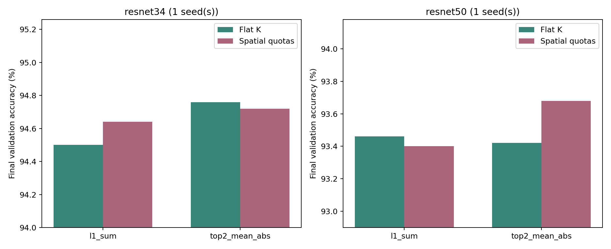

# Cross-filter配額粒度基準審核

完成：2026-11-02T00:59:42+08:00

## 比較定義

flat為目前整個Cin×Kh×Kw的共同配額；spatial為每(r,s)以global reference分攤保留數的解讀版。兩者每filter-cluster的總kept_count精確相同；不是拿較低sparsity換accuracy。

原文Figure4/5支持共享mask，但配額粒度及整數規則未唯一明確，spatial不得標為作者原始實作。圖示、原文位置與假設見source_snapshot內計畫。

## 相同預算結果

| Model | Criterion | Seeds | Flat val (%) | Spatial val (%) | Spatial-flat (pp) | Paired std (pp) |
|---|---|---:|---:|---:|---:|---:|
| resnet34 | l1_sum | 1 | 94.500 | 94.640 | +0.140 | N/A |
| resnet34 | top2_mean_abs | 1 | 94.760 | 94.720 | -0.040 | N/A |
| resnet50 | l1_sum | 1 | 93.460 | 93.400 | -0.060 | N/A |
| resnet50 | top2_mean_abs | 1 | 93.420 | 93.680 | +0.260 | N/A |

## 下一階段決策

No >=0.3pp mean baseline gap in this bounded audit

若進入分類梯度pilot，會另立凍結方法與檔案，不把結果混入本表。若未進入，先處理基準敏感性。0.3pp是投入控制門檻，不是統計顯著或等效檢定。

## 可重現性

全部分支固定Dense checkpoint、相同split、Tm8、無保護/cap、10epochs SGD fine-tune及RNG。只評估5000張validation，不使用test。flat masks與現有核心逐元素一致；1×1兩版完全一致。VALIDATION.json另檢查每cluster配額、不同工作重新生成mask一致性及來源SHA。

每分支含clusters.csv、spatial_counts.csv、mask_report.json及完整log。獨立round的空間配額誤差也保留。總訓練與問題處理見execution.jsonl及EXECUTION_LOG.md。
