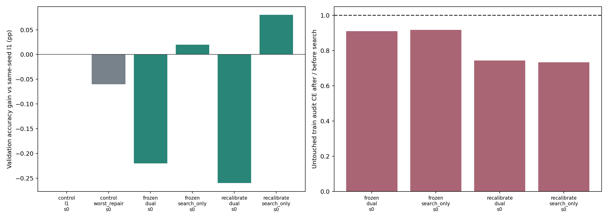

# 全模型分類Loss篩選共享Mask：實驗結果

整理：2026-11-02T00:12:04+08:00

## 固定條件

ResNet50、CIFAR-10、Tm8連續分組、實際約90%剪枝。每cluster kept_count逐元素匹配l1；只換mask，不重分配剪枝預算。每分支相同Dense checkpoint與10epoch fine-tune，搜尋BN統計不帶入訓練。

search 512 / check 512 / audit 1024均來自互斥train；dual使用check做否決，故check不是獨立測試。audit僅搜尋開始及結束量測；validation5000張用於開發決策。沒有使用test。

候選來自已固定的mean/worst局部重建mask；逐層在目前完整剪枝網路比較CE，一次選一個候選，保留其他已接受的mask。search_only是消融，主方法固定為dual。

## 分類結果

| BN proxy | Policy | Seed | Direct val (%) | 10ep val (%) | vs l1 (pp) | Accepted layers |
|---|---|---:|---:|---:|---:|---:|
| control | l1 | 0 | 10.080 | 93.460 | +0.000 |  |
| control | worst_repair | 0 | 10.920 | 93.400 | -0.060 |  |
| frozen | dual | 0 | 17.080 | 93.240 | -0.220 | 26 |
| frozen | search_only | 0 | 17.320 | 93.480 | +0.020 | 32 |
| recalibrate | dual | 0 | 10.040 | 93.200 | -0.260 | 26 |
| recalibrate | search_only | 0 | 10.040 | 93.540 | +0.080 | 38 |

## 判斷

frozen與BN重新校正兩種proxy均未讓dual達到預設的l1提升至少0.1pp、且不低於無條件worst_repair的條件，因此未擴大三seed。保留負結果，不從search_only或多次試驗中改挑贏家。

分類proxy改善不等於fine-tune後accuracy改善；局部候選庫仍受Dense teacher輸入限制。若結果不佳，可能是候選庫或未訓練模型proxy不適合預測可訓練性，但這些原因尚未被分離證實。

## 重現與限制

程式、計畫、資料隔離檢查、mask、逐層journal、所有訓練logs與來源SHA均保留。VALIDATION.json檢查精確配額、原baseline一致、資料隔離及逐層接受條件。checkpoint與CIFAR資料仍在本機，不含於ZIP。

主方法及調整均屬待驗證研究，不主張整網路loss搜尋或BN校正本身新穎。不使用更多fine-tune epochs來補救新方法，也不把單seed的小幅差異當成統計顯著。

計畫：../../research_notes/2026-11-02_task_loss_mask_plan.md；工作及問題紀錄：execution.jsonl、EXECUTION_LOG.md。
